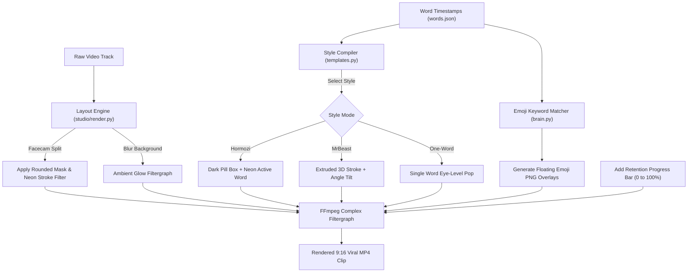

# Engineering Plan 01 — Design & Visual Enhancements

> **Plan ID**: `PLAN-01`  
> **Status**: **Completed (Implemented & Verified)**  
> **Target Modules**: [`studio/templates.py`](file:///E:/YouTube/Automation/Clipper/studio/templates.py), [`studio/render.py`](file:///E:/YouTube/Automation/Clipper/studio/render.py), [`studio/brain.py`](file:///E:/YouTube/Automation/Clipper/studio/brain.py)  
> **Estimated Effort**: 3 Days  

---

## 1. Executive Summary & Goals

The goal of this plan is to transform the visual output of Clipper from basic functional clips into **high-production viral shorts** that match the retention standards of top creators (Alex Hormozi, MrBeast, Submagic).

### Key Features to Implement:
1. **Three New Viral Subtitle Presets**:
   - `Hormozi Pill Box`: Dark translucent pill backing with neon green (`#22C55E`) or neon yellow (`#FFE600`) text.
   - `MrBeast 3D Glow`: 3-layer drop shadow, 10px outer stroke, vibrant yellow/cyan, with slight dynamic tilt (`\frz-2`).
   - `One-Word Rapid Fire`: Giant eye-level single words (`fs170`) that flash rapidly for ultra-fast-paced speech.
2. **Watch-Time Retention Progress Bar**:
   - A slim, elegant progress line at the bottom or top of the 9:16 frame (`0%` $\to$ `100%`) showing remaining duration.
3. **Auto-Emoji & Keyword Highlight Engine**:
   - Automatically detect high-emotion keywords ("money", "fire", "shock", "growth", "car") and display animated floating emoji icons above the active word.
4. **Enhanced Facecam Framing**:
   - Add rounded corner masks (`radius=24px`) and a glowing neon border around the streamer webcam box.
5. **Auto-Fading Hook Header Cards**:
   - The top hook title appears prominently for 3.5 seconds to hook the viewer, then smoothly fades out (`\fad(0, 400)`) to unclutter the video.

---

## 2. Architecture & Compositing Flow



---

## 3. Technical Specifications & Concrete Code Changes

### 3.1. Subtitle Presets in `studio/templates.py`
Add three new ready-made templates to `BUILTIN` in `studio/templates.py`:

```python
# In studio/templates.py
BUILTIN.extend([
    {
        "id": "b-hormozi",
        "name": "Hormozi Pill",
        "look": _look(
            {
                "anim": "box",
                "font": "Poppins Black",
                "size": 126,
                "color": "FFFFFF",
                "hi": "22C55E",      # Vivid Emerald Green
                "key": "FFE600",     # Neon Yellow
                "bg": True,
                "bgc": "1A1A1A",     # Dark Translucent Pill
                "outline": 0,
                "shadow": False,
                "per": 2,
                "pop": 115
            },
            hook={"show": True, "bg": True, "bgc": "22C55E", "color": "000000"}
        )
    },
    {
        "id": "b-mrbeast",
        "name": "MrBeast 3D",
        "look": _look(
            {
                "anim": "pop",
                "font": "Anton",
                "size": 154,
                "color": "FFFFFF",
                "hi": "FFE600",      # Vibrant Yellow
                "outline": 10,       # Heavy 10px Black Stroke
                "shadow": True,
                "per": 2,
                "upper": True,
                "pop": 118
            },
            hook={"show": True, "bg": True, "bgc": "FFE600", "color": "000000"}
        )
    },
    {
        "id": "b-rapid",
        "name": "Rapid Fire (One Word)",
        "look": _look(
            {
                "anim": "pop",
                "font": "Luckiest Guy",
                "size": 175,
                "color": "FFFFFF",
                "hi": "00F0FF",      # Electric Cyan
                "outline": 9,
                "shadow": True,
                "per": 1,           # Exactly 1 word at a time
                "pop": 110,
                "y": 55             # Positioned at upper center eye-level
            },
            hook={"show": False}    # No top hook to maximize screen focus
        )
    }
])
```

---

### 3.2. Retention Progress Bar in `studio/render.py`
In `studio/render.py`, inject a dynamic horizontal progress line into the FFmpeg filtergraph:

```python
def _progress_bar_filter(clip_dur: float, height: int = 8, color: str = "00F0FF@0.85") -> str:
    """Generates FFmpeg drawbox expression for a 0% -> 100% progress line at bottom."""
    return (
        f"drawbox=x=0:y=ih-{height}:w='min(iw,iw*(t/{clip_dur}))':h={height}:"
        f"color={color}:t=fill"
    )
```

---

### 3.3. Auto-Fading Hook Header in `studio/render.py`
Currently, the hook box persists for the entire clip. We update the ASS event generator to fade out after 3.5 seconds:

```python
# In studio/render.py - _hook_events()
hook_dur = min(3.5, dur)  # Visible for 3.5 seconds only
ev.append(
    f"Dialogue: 3,{_ts(0)},{_ts(hook_dur)},Hook,,0,0,0,,"
    f"{{\\an7\\pos(0,0)\\fad(160,350)\\c&H{boxc}&\\p1}}{box}{{\\p0}}"
)
for line in lines:
    ev.append(
        f"Dialogue: 4,{_ts(0)},{_ts(hook_dur)},Hook,,0,0,0,,"
        f"{{\\an5\\pos({cx:.0f},{mid - f.cap_shift(size):.0f})\\fad(160,350)\\fs{size}{txt}}}{line}"
    )
```

---

### 3.4. Auto-Emoji & Keyword Highlight Engine
1. **Keyword Map**: Create `studio/emoji/keywords.json` mapping high-frequency emotion words to bundled Apple/Twemoji icons:
   ```json
   {
     "money": "money_bag.png",
     "cash": "money_bag.png",
     "fire": "fire.png",
     "insane": "exploding_head.png",
     "crazy": "exploding_head.png",
     "win": "trophy.png",
     "car": "car.png"
   }
   ```
2. In `studio/render.py`, check word tokens. If a token matches a keyword, overlay the corresponding emoji PNG with a bounce scale above the word position for its $[t_{\text{start}}, t_{\text{end}}]$ duration.

---

## 4. Implementation Steps & Verification

- [ ] **Step 1**: Add `b-hormozi`, `b-mrbeast`, and `b-rapid` templates to `studio/templates.py`.
- [ ] **Step 2**: Add auto-fade timing (`\fad(160, 350)`) to hook headers in `studio/render.py`.
- [ ] **Step 3**: Add retention progress bar filter to `studio/render.py`.
- [ ] **Step 4**: Test rendering on `data/users/u_local/style-sample.mp4` and verify visually.
- [ ] **Step 5**: Commit changes to `develop` branch.
