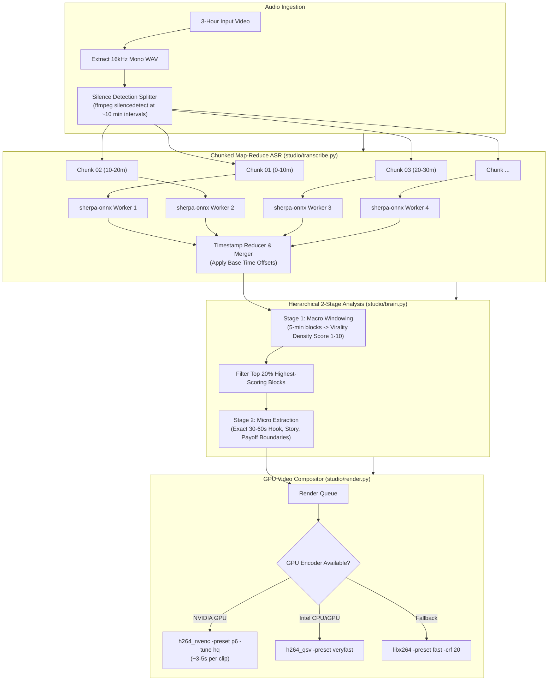

# Engineering Plan 02 — Long Video Support & GPU Hardware Acceleration

> **Plan ID**: `PLAN-02`  
> **Status**: **Approved (Ready for Implementation)**  
> **Target Modules**: [`studio/transcribe.py`](file:///E:/YouTube/Automation/Clipper/studio/transcribe.py), [`studio/jobs.py`](file:///E:/YouTube/Automation/Clipper/studio/jobs.py), [`studio/brain.py`](file:///E:/YouTube/Automation/Clipper/studio/brain.py), [`studio/render.py`](file:///E:/YouTube/Automation/Clipper/studio/render.py), [`.env`](file:///E:/YouTube/Automation/Clipper/.env)  
> **Estimated Effort**: 4 Days  

---

## 1. Executive Summary & Goals

Processing long-form videos (e.g., 2 to 4-hour podcasts like Lex Fridman or Joe Rogan, long Twitch VODs, and webinars) currently presents two major performance bottlenecks:
1. **ASR & Memory Bottleneck**: Transcribing a 3-hour audio file in a single pass consumes large RAM buffers and cannot utilize multi-threading across audio chunks.
2. **LLM Context Window Overload**: Passing a 40,000-word transcript into a single LLM prompt degrades context attention and increases API token costs.
3. **CPU Video Encoding Latency**: Rendering vertical 1080x1920 MP4 clips with CPU (`libx264`) takes 30–60 seconds per clip.

### Solution Architecture:
- **Chunked Silence-Aware Map-Reduce ASR**: Split audio into 10-minute segments at natural silence points and transcribe in parallel across CPU threads.
- **Hierarchical 2-Stage LLM Slicing**: Stage 1 evaluates 5-minute macro blocks for virality density; Stage 2 extracts exact hook/story/payoff windows only on top-scoring blocks.
- **GPU Hardware Acceleration**: Support NVIDIA NVENC (`h264_nvenc`), Intel QuickSync (`h264_qsv`), and AMD AMF (`h264_amf`) for 5x–10x faster FFmpeg rendering.

---

## 2. Architecture & Pipeline Diagram



---

## 3. Concrete Implementation Specifications

### 3.1. Chunked Map-Reduce in `studio/transcribe.py`
Add chunked parallel transcription support:

```python
# In studio/transcribe.py
from concurrent.futures import ThreadPoolExecutor

def transcribe_long_audio(wav_path: Path, chunk_len_sec: int = 600) -> list:
    """Splits long audio into ~10 min chunks and transcribes in parallel."""
    # 1. Identify silence split points near chunk_len_sec using ffmpeg silencedetect
    split_points = get_silence_split_points(wav_path, target_interval=chunk_len_sec)
    
    # 2. Extract split WAVs to temp directory
    chunks = split_wav_file(wav_path, split_points)
    
    # 3. Transcribe chunks in parallel
    results = []
    with ThreadPoolExecutor(max_workers=min(4, os.cpu_count())) as executor:
        futures = [
            executor.submit(transcribe_chunk, chunk_path, offset_seconds)
            for chunk_path, offset_seconds in chunks
        ]
        for f in futures:
            results.extend(f.result())
            
    # 4. Sort and return unified word list
    results.sort(key=lambda w: w["start"])
    return results
```

---

### 3.2. 2-Stage Hierarchical LLM Analysis in `studio/brain.py`
Prevent context window overload on 2+ hour videos:

1. **Stage 1 (Macro Evaluation)**:
   - Slice full transcript into 5-minute blocks.
   - Prompt LLM with topic summaries to rank each block's virality density (1–10).
   - Drop bottom 80% (banter, introductions, sponsor reads, technical setups).
2. **Stage 2 (Micro Extraction)**:
   - Send only the top-ranked blocks into the detailed candidate extraction prompt.
   - Guarantees top-quality viral clips while saving ~75% of LLM token costs.

---

### 3.3. GPU Hardware Acceleration in `studio/render.py`
Check for hardware encoders and use them automatically if present:

```python
# In studio/render.py
def _get_video_encoder():
    """Detects available hardware encoder from .env or ffmpeg query."""
    configured = os.getenv("PEAKCUT_FFMPEG_ENCODER")
    if configured:
        return configured
        
    # Auto-detect NVENC availability
    try:
        res = subprocess.run(
            ["ffmpeg", "-hide_banner", "-encoders"],
            capture_output=True, text=True, check=True
        )
        if "h264_nvenc" in res.stdout:
            return "h264_nvenc"
        if "h264_qsv" in res.stdout:
            return "h264_qsv"
    except Exception:
        pass
    return "libx264"
```

---

## 4. Implementation Steps & Verification

- [ ] **Step 1**: Implement `_get_video_encoder()` and hardware flags in `studio/render.py`.
- [ ] **Step 2**: Add `PEAKCUT_FFMPEG_ENCODER` environment configuration to `.env`.
- [ ] **Step 3**: Benchmark NVENC encoding speed vs CPU encoding on a 60-second clip.
- [ ] **Step 4**: Implement 2-stage hierarchical slicing in `studio/brain.py`.
- [ ] **Step 5**: Implement chunked audio splitter in `studio/transcribe.py`.
- [ ] **Step 6**: Test with a 2-hour YouTube video and verify memory stability.
