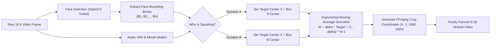

# Engineering Plan 03 — Active Speaker Tracking (Pan & Scan)

> **Plan ID**: `PLAN-03`  
> **Status**: **Draft (Under Review)**  
> **Target Modules**: [`studio/facecam.py`](file:///E:/YouTube/Automation/Clipper/studio/facecam.py), [`studio/render.py`](file:///E:/YouTube/Automation/Clipper/studio/render.py)  
> **Estimated Effort**: 5 Days  

---

## 1. Executive Summary & Goals

When converting horizontal 16:9 podcast and interview videos (e.g., Lex Fridman, Joe Rogan, Huberman Lab) into vertical 9:16 shorts, a static center-crop often cuts off the active speaker or awkwardly frames empty space between the host and the guest.

### Objectives:
1. Automatically detect all faces in the 16:9 video frame using OpenCV YuNet.
2. Correlate who is currently speaking using Voice Activity Detection (VAD) and mouth aspect ratio ($MAR$).
3. Dynamically shift the 9:16 vertical crop window using an **Exponential Moving Average (EMA) / Kalman filter** to create smooth, natural camera panning without jerky jumps.

---

## 2. Algorithmic Workflow

---

## 3. Mathematical Model for Smooth Panning

To prevent disorienting camera movements when switching between speakers:

$$X_t = \alpha \cdot X_{\text{target}} + (1 - \alpha) \cdot X_{t-1}$$

Where:
- $X_{\text{target}}$ is the horizontal center of the active speaker's face.
- $X_{t-1}$ is the camera position in the previous frame.
- $\alpha \approx 0.06$ to $0.10$ provides cinematic camera acceleration and deceleration (ease-in / ease-out).
- When a speaker switch occurs, a minimum 1.5-second dwell threshold prevents the camera from bouncing back and forth on brief filler words ("uh-huh", "yeah").

---

## 4. Implementation Checklist

- [ ] **Step 1**: Add OpenCV YuNet lightweight face detection model (`face_detection_yunet_2023mar.onnx`) into `data/models/`.
- [ ] **Step 2**: Implement `track_active_speakers()` in `studio/facecam.py` returning an array of $(t, x_{\text{crop}})$ keyframes.
- [ ] **Step 3**: Compile trajectory into an FFmpeg `crop` filter expression (`crop=w=ih*9/16:h=ih:x='...':y=0`).
- [ ] **Step 4**: Add UI toggle `[x] Active Speaker Tracking (Pan & Scan)` to Job creation options.
