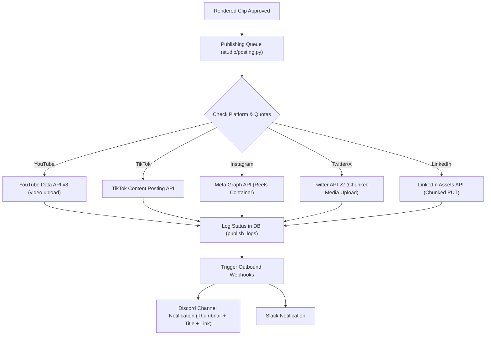

# Engineering Plan 04 — Multi-Platform Publishing & Webhook Automation

> **Plan ID**: `PLAN-04`  
> **Status**: **Draft (Under Review)**  
> **Target Modules**: [`studio/posting.py`](file:///E:/YouTube/Automation/Clipper/studio/posting.py), [`studio/accounts.py`](file:///E:/YouTube/Automation/Clipper/studio/accounts.py), [`studio/db.py`](file:///E:/YouTube/Automation/Clipper/studio/db.py)  
> **Estimated Effort**: 3 Days  

---

## 1. Executive Summary & Goals

Clipper currently supports OAuth2 publishing to YouTube Shorts, TikTok, and Instagram Reels. This plan expands publishing reach to professional and micro-blogging video feeds, and introduces automated event webhooks for Discord and Slack communities.

### Key Objectives:
1. **Twitter / X Video Integration**: Direct upload of 9:16 vertical video using Twitter API v2 chunked media upload.
2. **LinkedIn Video Integration**: Direct posting to LinkedIn personal feeds and company pages via the LinkedIn Assets API.
3. **Automated Event Webhooks**: Send Discord or Slack notifications when:
   - A video finishes processing with all clips ready.
   - A live stream spike trigger occurs.
   - A clip is successfully published to social media.
4. **Anti-Spam Rate Limiter**: Configurable time intervals (e.g., minimum 4 hours between posts) and daily posting quotas to protect channel reputation.

---

## 2. Publishing Workflow Architecture

---

## 3. Implementation Checklist

- [ ] **Step 1**: Register Twitter / X developer app and add OAuth2 endpoints in `studio/accounts.py`.
- [ ] **Step 2**: Implement chunked video upload (`INIT`, `APPEND`, `FINALIZE`) in `studio/posting.py`.
- [ ] **Step 3**: Add Discord Webhook URL input in **Settings $\to$ Notifications**.
- [ ] **Step 4**: Format Discord rich embed with clip thumbnail, AI hook title, and virality score.
- [ ] **Step 5**: Test multi-platform publishing and webhook delivery.
