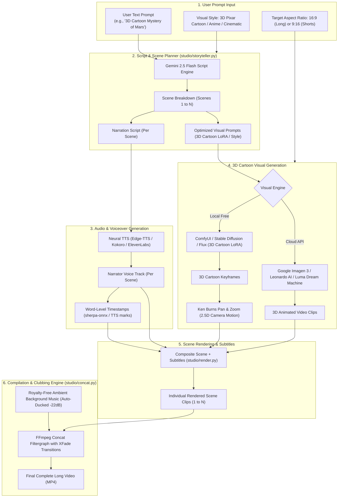

# Engineering Plan 05 — Prompt-to-Video AI Storyteller & Clip Compilation Engine

> **Plan ID**: `PLAN-05`  
> **Status**: **Approved (Ready for Architecture & Prototyping)**  
> **Target Modules**: `studio/storyteller.py` (New), `studio/concat.py` (New), [`studio/render.py`](file:///E:/YouTube/Automation/Clipper/studio/render.py), [`studio/server.py`](file:///E:/YouTube/Automation/Clipper/studio/server.py), [`web/index.html`](file:///E:/YouTube/Automation/Clipper/web/index.html)  
> **Estimated Effort**: 7 Days  

---

## 1. Executive Summary & Goals

This plan extends Clipper from an *extractive repurposing tool* into a **full generative AI studio**:
1. **Prompt-to-Video Engine (Generative AI Storyteller)**:
   - Users input a text prompt (e.g., *"Create a 5-minute 3D cartoon story about a young detective cat solving mysteries in a cyberpunk city"*).
   - The engine automatically writes a multi-scene script, generates high-quality 3D cartoon visuals/video clips, synthesizes natural voiceover, applies synchronized subtitles, and stitches everything into a complete long video.
2. **Clip Clubbing / Compilation Builder**:
   - Users can select any number of extracted or generated clips from their feed and click **"Club into Long Video"**.
   - The system concatenates the clips with smooth crossfade transitions, introductory title cards, outro hooks, and unified background music into a 5- to 20-minute long-form YouTube video.

---

## 2. End-to-End Generative Architecture



---

## 3. Core Subsystems & Technical Design

### 3.1. Compilation Builder: Clubbing Clips into a Long Video
When users want to stitch multiple viral clips into a single compilation (e.g., *"Top 10 Moments of the Stream"*):
- **FFmpeg `xfade` (Crossfade Transition)**:
  Instead of an abrupt cut, clips transition seamlessly using subtle 0.5-second crossfades, dissolves, or wipes:
  ```bash
  ffmpeg -i clip1.mp4 -i clip2.mp4 -filter_complex \
    "[0:v][1:v]xfade=transition=fade:duration=0.5:offset=29.5[v]; \
     [0:a][1:a]acrossfade=d=0.5[a]" \
    -map "[v]" -map "[a]" long_video.mp4
  ```
- **Automated Title Interstitials**:
  Insert a 2-second numbered title card between clips (e.g., *"Clip #2: The Crazy Clutch"*).

---

### 3.2. 3D Cartoon Visual Generation Pipeline
To create consistent 3D cartoon aesthetics without expensive manual animation:

1. **Consistent Character & World Generation**:
   - The LLM appends consistent character descriptions and visual anchors to each scene prompt:
     `"pixar style 3d render, octane render, soft volumetric lighting, disney animation aesthetic, vibrant colors, expressive character face, 8k resolution"`
2. **Motion Implementation (Two Options)**:
   - **Option A (Fast & 100% Free - 2.5D Ken Burns)**:
     Takes high-resolution 3D cartoon stills and applies dynamic camera zooming, panning, and parallax tilt using FFmpeg `zoompan`:
     `zoompan=z='min(zoom+0.0015,1.25)':d=125:x='iw/2-(iw/zoom/2)':y='ih/2-(ih/zoom/2)'`
   - **Option B (Full AI Video)**:
     Integrates with Image-to-Video models (Luma Dream Machine API, Runway Gen-3, or local AnimateDiff / SVD) to animate characters with 3D cartoon motion.

---

### 3.3. Neural Voiceover (Edge-TTS Integration)
Zero-cost, broadcast-quality neural voiceover running offline/direct via `edge-tts`:
```python
import edge_tts

async def generate_narration(text: str, out_path: str, voice: str = "en-US-ChristopherNeural"):
    """Generates natural neural voiceover with millisecond-exact word timing."""
    communicate = edge_tts.Communicate(text, voice)
    submaker = edge_tts.SubMaker()
    with open(out_path, "wb") as file:
        async for chunk in communicate.stream():
            if chunk["type"] == "audio":
                file.write(chunk["data"])
            elif chunk["type"] == "WordBoundary":
                submaker.create_sub((chunk["offset"], chunk["duration"]), chunk["text"])
```

---

## 4. UI Dashboard Extensions in `web/index.html`

Two new interface tabs will be added:
1. **"Storyteller (Prompt-to-Video)" Tab**:
   - Text prompt input box.
   - Style dropdown: `3D Pixar Cartoon`, `Cyberpunk Anime`, `Cinematic Realistic`, `Watercolor Storybook`.
   - Voice selector: Male/Female narrator voices.
   - Aspect ratio: `16:9 Widescreen` (YouTube) or `9:16 Vertical` (Shorts/Reels).
2. **"Club Clips (Compilation)" Modal**:
   - In the Feed view, multi-select checkboxes on clips.
   - **"Club into Long Video"** button.
   - Re-order clips via drag-and-drop, choose transition style (Fade, Wipe, Slide), and pick optional background music.

---

## 5. Implementation Roadmap Checklist

- [ ] **Phase 1: Concat / Clubbing Engine (`studio/concat.py`)**
  - Implement FFmpeg `xfade` concatenation for existing clips.
  - Add "Club into Video" multi-select UI in the dashboard.
- [ ] **Phase 2: Neural Voiceover Engine (`studio/tts.py`)**
  - Install `edge-tts` and wire audio generation with word boundary extraction.
- [ ] **Phase 3: LLM Scene Planner (`studio/storyteller.py`)**
  - Prompt Gemini to structure any user topic into a 6-to-12 scene story script with visual prompts.
- [ ] **Phase 4: 3D Cartoon Visual Generator**
  - Implement 3D cartoon style prompt templates + Ken Burns dynamic camera animator.
  - Add optional cloud Image-to-Video API bridge (Imagen 3 / Luma).
- [ ] **Phase 5: Master Pipeline Integration**
  - Connect Storyteller output directly into the Concat Engine for one-click prompt-to-long-video generation.
