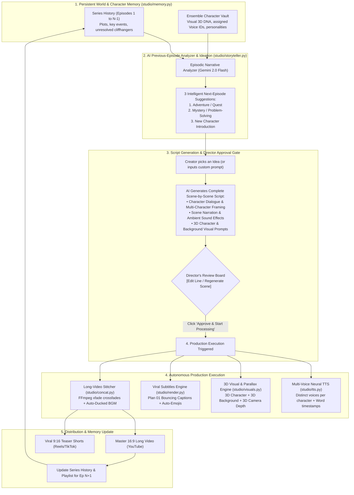

# Engineering Plan 05 — Autonomous 3D Episodic Series, Storyteller & Compilation Engine

> **Plan ID**: `PLAN-05`  
> **Status**: **Approved (Finalized Master Blueprint)**  
> **Target Modules**: `studio/memory.py` (New), `studio/storyteller.py` (New), `studio/tts.py` (New), `studio/visuals.py` (New), `studio/concat.py` (New), [`studio/render.py`](file:///E:/YouTube/Automation/Clipper/studio/render.py), [`studio/server.py`](file:///E:/YouTube/Automation/Clipper/studio/server.py), [`web/index.html`](file:///E:/YouTube/Automation/Clipper/web/index.html)  
> **Estimated Effort**: 7 Days  

---

## 1. Executive Summary & Vision

This plan extends Clipper from an extractive clip-cutting utility into a **fully autonomous 3D episodic animation and storytelling studio**.

Users can establish recurring **Shows, Series, and Playlists** (e.g. 3D cartoon animal adventures, gaming lore, cyberpunk mysteries, or educational series). The engine operates autonomously from a single high-level seed prompt while giving creators complete editorial control through a **Director's Script Approval Gate** before video rendering begins.

### Core Architectural Pillars:

1. **Zero-Manual Dependence (Autonomous Pipeline)**:
   - The user provides a simple prompt (or clicks *"Generate Next Episode"*).
   - The AI automatically handles:
     - Analyzing previous episodes to determine narrative continuity.
     - Formulating 3 intelligent next-episode concept pitches.
     - Writing the complete scene-by-scene script with ensemble character dialogue and narrative pacing.
     - Generating consistent 3D character and background visual prompts.
     - Synthesizing distinct neural character voices with millisecond-exact word timestamps.
     - Rendering high-gloss 3D visuals with dynamic 3D camera parallax and depth effects.
     - Aligning viral bouncing subtitles with auto-emojis.
     - Stitching all scenes into finished **16:9 Long-Form Videos** and **9:16 Shorts**.

2. **Persistent Character & Ensemble Memory Vault**:
   - Stores persistent character profiles (3D visual DNA, clothing, facial proportions, color palette, assigned voice ID, and personality).
   - Recurring characters (like in *The Simpsons*, *RooRoo Friends*, or *Cocomelon*) remain 100% visually and vocally consistent across episodes.
   - New characters can be organically introduced into new episodes and registered in memory.

3. **AI Previous-Episode Analysis & 3 Smart Next-Episode Suggestions**:
   - The engine reads past episode summaries, resolved events, and open cliffhangers.
   - Proactively generates **3 creative Next-Episode Pitches** (e.g., Adventure, Mystery, or New Character Introduction) so the creator never has to brainstorm from scratch.

4. **Human-in-the-Loop Script Review & Approval Gate**:
   - Before any heavy video/audio rendering starts, the creator reviews the generated scene-by-scene script, character dialogues, and visual scene settings.
   - Creators can make quick line edits, re-roll a scene, and click **"Approve & Start Processing"**.

5. **High-Polish 3D Character & Background Engine (Benchmark: RooRoo / Pixar CGI)**:
   - High-gloss 3D characters with soft specular lighting and stylized/chibi or standard proportions.
   - Rich 3D background environments with depth of field, volumetric atmosphere, and vibrant color palettes.
   - Dynamic multi-plane 3D camera depth motion (dolly-in, parallax pan, tilt) in FFmpeg.

6. **Dual Formats & Compilation Builder**:
   - Renders master **16:9 Widescreen Long Episodes** (3–15 mins) for YouTube.
   - Automatically cuts **9:16 Vertical Shorts** (30–60s) for TikTok, Reels, and Shorts.
   - Concatenates scenes with smooth crossfade transitions (`xfade`) and auto-ducked background music.

---

## 2. End-to-End Generative Architecture



---

## 3. Subsystem Specifications & Engineering Design

### 3.1. Persistent Memory Engine (`studio/memory.py`)
Stores character profiles and episode histories under `data/series/<series_id>/`:

```python
# data/series/<series_id>/series.json
{
  "id": "farm-friends-3d",
  "title": "Farm Friends 3D Adventures",
  "genre": "3D Cartoon Adventure",
  "visual_style": "high-gloss 3D Pixar toy CGI, octane render, soft volumetric lighting, vibrant primary colors, 8k",
  "aspect_ratio": "16:9",
  "characters": [
    {
      "id": "roo",
      "name": "Roo",
      "species": "Playful Monkey",
      "visual_anchor": "cute 3d chibi monkey, brown smooth fur, wearing blue denim overalls, big expressive eyes, smiling",
      "voice_id": "en-US-ChristopherNeural",
      "personality": "Energetic, curious leader who loves exploring"
    },
    {
      "id": "barnaby",
      "name": "Barnaby",
      "species": "Gentle Bull",
      "visual_anchor": "cute 3d cartoon bull, soft brown and white patches, small rounded horns, wearing yellow bandana",
      "voice_id": "en-US-EricNeural",
      "personality": "Gentle giant, loves eating grass and apples, cautious"
    }
  ],
  "episodes": [
    {
      "episode_num": 1,
      "title": "The Great Farm Picnic",
      "summary": "Roo and Barnaby prepared a farm feast but found the orchard gates locked. Together they found the hidden key under the old windmill.",
      "unresolved_hook": "A strange mechanical humming sound was heard from the barn cellar at sunset.",
      "completed_at": "2026-11-26T21:00:00Z"
    }
  ]
}
```

---

### 3.2. Storyteller & Next-Episode Ideation (`studio/storyteller.py`)

Using the configured Gemini API key:

1. **`pitch_next_episodes(series_id) -> list[dict]`**:
   - Reads the previous episode summaries and unresolved cliffhangers.
   - Prompts Gemini to return 3 distinct episode concepts:
     - `concept_type`: `"adventure" | "mystery" | "new_character"`
     - `title`: Catchy episode title.
     - `logline`: 2-sentence synopsis.
     - `featured_characters`: Recurring cast + any newly introduced character.

2. **`generate_episode_script(series_id, pitch) -> dict`**:
   - Takes the selected pitch and generates an episodic script with 6–12 scenes:
     - Per scene: `scene_index`, `speaker` (character name or narrator), `dialogue`, `narration`, `camera_motion` (dolly-in, pan-left, zoom-depth), and `visual_prompt`.
     - Multi-Character Spatial Framing:
       ```
       "Wide 3D render, Roo the monkey on the left in blue overalls, Barnaby the bull on the right, looking down together into an open cellar trapdoor, sunny farm barn interior, pixar octane render, soft volumetric lighting"
       ```

---

### 3.3. Multi-Voice Neural TTS Engine (`studio/tts.py`)

Integrates `edge-tts` to generate crystal-clear, broadcast-quality character dialogue and narrator tracks:

```python
import edge_tts
import asyncio

async def synthesize_scene_voice(text: str, voice_id: str, out_wav: Path) -> list[dict]:
    """Synthesizes speech and extracts millisecond-exact word boundaries."""
    communicate = edge_tts.Communicate(text, voice_id)
    submaker = edge_tts.SubMaker()
    words = []
    with open(out_wav, "wb") as f:
        async for chunk in communicate.stream():
            if chunk["type"] == "audio":
                f.write(chunk["data"])
            elif chunk["type"] == "WordBoundary":
                words.append({
                    "w": chunk["text"],
                    "s": chunk["offset"] / 10_000_000,   # 100ns units to seconds
                    "e": (chunk["offset"] + chunk["duration"]) / 10_000_000
                })
    return words
```

---

### 3.4. True 3D Animation & Multi-Plane Parallax Engine (`studio/visuals.py`)

To eliminate flat, static 2D images with simple zoom pans, the engine implements a **Procedural 3D Character & Multi-Plane Animation Architecture**:

1. **Multi-Plane Z-Depth Occlusion & Parallax**:
   - Decomposes the scene into three distinct spatial depth planes:
     - **Background Sky & Celestial Plane ($Z = 3.0$)**: Radial atmospheric gradient, volumetric warm sun, floating cartoon clouds moving at minimal velocity ($v_{bg} = 0.2\times$).
     - **Midground Scenery Plane ($Z = 1.8$)**: Rolling 3D hills, red rustic barn, stylized trees, and wooden fences ($v_{mg} = 0.5\times$).
     - **Foreground 3D Character Rig ($Z = 1.0$)**: Active speaking 3D character translating at foreground camera speed ($v_{fg} = 1.0\times$).
   - The velocity disparity between foreground ($1.0\times$) and background ($0.2\times$) creates **true optical 3D perspective parallax**.

2. **Character Skeletal Viseme & Facial Animation**:
   - **Speech Visemes (Lip-Sync)**: Character mouth dynamically animates open and closed in synchrony with dialogue audio amplitude, forming natural speech visemes.
   - **Eye Blinking Cycle**: Specular glossy catchlight eyes blink every 2.5–3.0 seconds over smooth arc curves.
   - **Idle Breathing Sway**: Torso and head execute gentle harmonic sinusoidal bobbing ($y_{sway} = 6\sin(2\pi f t)$), simulating natural character life.

3. **Advanced 3D Production Roadmap (Three.js & AI Diffusion)**:
   - **Tier 1 (Implemented - Local & Real-Time)**: Procedural multi-plane depth disparity + rigged facial visemes + FFmpeg video stream.
   - **Tier 2 (Headless WebGL / Three.js)**: Loading rigged GLTF/GLB 3D cartoon characters with PBR materials, bone skinning, and dynamic 3D camera orbits recorded to MP4.
   - **Tier 3 (AI 3D Video Diffusion)**: Integration with Wan2.1 / Stable Video Diffusion (SVD) / CogVideoX / ComfyUI APIs for full volumetric AI video generation.

---

### 3.5. Long Video & Compilation Stitcher (`studio/concat.py`)

Stitches scene clips with seamless 0.5-second crossfades and background music:

```python
def stitch_scenes_to_long_video(scene_files: list[Path], bgm_path: Path, out_path: Path):
    """Concatenates N scenes using FFmpeg xfade filtergraph with auto-ducked BGM (-22dB)."""
    # Dynamically builds:
    # [0:v][1:v]xfade=transition=fade:duration=0.5:offset=T1[v1];
    # [v1][2:v]xfade=transition=fade:duration=0.5:offset=T2[v2]...
```

---

### 3.6. Showrunner AI Audio Narrative & Continuity Walkthrough Engine (`studio/storyteller.py`, `studio/tts.py`)

To provide creators with instant creative clarity when designing or reviewing an episode, the engine generates an **AI Director's Narrative & Spoken Walkthrough**.

#### Narrative Structure:
1. **Context & Motivation**: Why this specific episode was conceived (audience target, genre beat, and narrative goal).
2. **Previous Episode Continuity Bridge**: How the episode directly connects to and builds upon the unresolved hook or consequences of Episode $N-1$.
3. **Current Episode Story Arc**: Key challenges, ensemble character dynamics, comedic/adventurous milestones, and moral or educational takeaways.
4. **Next Episode Foreshadowing**: The cliffhanger, clue, or question planted at the episode climax that sets up Episode $N+1$.

#### Audio Synthesis & In-App Playback:
- The narrative walkthrough is synthesized into a high-fidelity director voiceover MP3 using neural Edge TTS in the show's native language.
- Streamed directly via `/api/series/{sid}/episodes/{ep_num}/narrative/audio`.
- An interactive **`[ 🎧 Listen to Director's Narrative ]`** audio control allows creators to listen to the audio walkthrough directly inside the Script Review & Approval gate, Episode vault, and AI pitch cards.

---

## 4. UI Dashboard: "AI Series & Story Studio" (`web/index.html`)

A dedicated top-level section in Clipper's sidebar:

```
┌────────────────────────────────────────────────────────────────────────────────────────┐
│  🎬 AI Series Studio: [ Farm Friends 3D ▾ ]                       [ + New Show ]       │
│  [ Character Cast (4) ]  [ Episodes & Playlists (3) ]  [ ⚡ Create Next Episode ]       │
├────────────────────────────────────────────────────────────────────────────────────────┤
│                                                                                        │
│  ┌─ STEP 1: AI NEXT-EPISODE SUGGESTIONS (Based on Previous Episode 1) ───────────────┐  │
│  │ 💡 The AI analyzed Episode 1 and proposes 3 continuation story arcs:               │  │
│  │                                                                                    │  │
│  │  [●] Option 1 (Mystery): "The Secret of the Barn Cellar"                           │  │
│  │      Roo and Barnaby investigate the mechanical humming heard at the end of Ep 1.  │  │
│  │                                                                                    │  │
│  │  [ ] Option 2 (Adventure): "Journey to the Sunflower Valley"                       │  │
│  │      The team builds a wooden cart to help delivery apples across the stream.      │  │
│  │                                                                                    │  │
│  │  [ ] Option 3 (New Character): "Meet Oliver the Night Owl"                         │  │
│  │      A wise nocturnal owl moves into the barn attic with an ancient treasure map.  │  │
│  │                                                                                    │  │
│  │  Custom Twist / Seed Prompt: [ Optional custom direction...                      ] │  │
│  │                                                      [ ✨ Generate Episode Script ]│  │
│  └────────────────────────────────────────────────────────────────────────────────────┘  │
│                                                                                        │
│  ┌─ STEP 2: DIRECTOR'S SCRIPT REVIEW & APPROVAL GATE ─────────────────────────────────┐  │
│  │ 📖 Episode 2: "The Secret of the Barn Cellar" (Est. Duration: 3m 45s | 8 Scenes)  │  │
│  │ Cast: Roo, Barnaby, Oliver (New)                                                  │  │
│  │                                                                                    │  │
│  │ ┌ Scene 1 (0:00 - 0:25) ─────────────────────────────────────────────────────────┐ │  │
│  │ │ Speaker: Narrator | Setting: Sunny morning outside the red wooden barn         │ │  │
│  │ │ Dialogue: "The sun was rising, but an eerie sound was still echoing..."        │ │  │
│  │ │ Visual: Wide 3D render of Roo & Barnaby standing near the cellar wooden doors  │ │  │
│  │ │ [✏️ Edit Line]  [🔄 Regenerate Scene]                                           │ │  │
│  │ └────────────────────────────────────────────────────────────────────────────────┘ │  │
│  │                                                                                    │  │
│  │ Subtitle Preset: [ Hormozi Green Pill ▾ ]   Format: [ 📺 16:9 Long + 📱 9:16 Shorts ]│
│  │                                               [ 🚀 Approve & Start Full Processing]│  │
│  └────────────────────────────────────────────────────────────────────────────────────┘  │
└────────────────────────────────────────────────────────────────────────────────────────┘
```

### 4.1. Unified PeakCut In-App Cinema & Episode Studio Dialog (`#clipdlg`, `.ce2.ce3`)

All generated episodes (both long-form 16:9 master videos and 9:16 vertical shorts) utilize **PeakCut's native dual-pane editor dialog architecture (`#clipdlg`)** rather than external browser tabs or download dialogs:

- **Left Pane (`.ce2-l`) — In-App Cinema Video Player**:
  - Full custom video engine (`.vp`) with centered big play toggle (`.vp-big`), bottom gradient control bar (`.vp-bar`), scrub seekbar (`.vp-seek`), precise timestamp counter (`.vp-t`), audio mute/unmute (`.vp-mute`), and native fullscreen (`.vp-fs`).
  - **In-Modal Aspect Ratio Switcher**:
    - Segmented glassmorphic toggle at the top of the video player:
      `[ 📺 16:9 Master (1080p) | 📱 9:16 Short (Vertical) ]`
    - Seamlessly switches between the 16:9 full master episode and 9:16 viral short without opening popups or reloading.
  - Dynamically adapts column width: widescreen 16:9 layout (`.ce2-16-9`) for master episodes, and compact 9:16 layout for vertical shorts.
- **Right Pane (`.ce2-r`) — Episode Narrative & Style Studio**:
  - **Episode Title with AI Rewriter**: Title field paired with `${ic("bolt")} Write again with AI` button.
  - **Story Synopsis & Narrative Arc**: Editable synopsis textarea.
  - **Showrunner AI Director's Spoken Walkthrough**:
    - Embedded audio player streaming `/api/series/{sid}/episodes/{ep}/narrative/audio`.
    - 4-Pillar continuity cards (`💡 Why Chosen`, `⏪ Previous Bridge`, `📖 Current Arc`, `⏩ Next Teaser`).
  - **Visual 3D Style & Subtitle Theme Chip**: Displays current 3D aesthetic DNA (e.g. *Pixar 3D Toy*) and subtitle look, with 1-click theme switcher.
  - **Featured Cast**: Character avatar pills.
  - **Footer Actions**: Direct `📥 Download MP4` button (`?download=1`), `Save`, and `Done`.

### 4.2. Multi-Scene Long Video Generation & Interactive Script Editor

To support long-form storytelling (3–10 minutes) rather than static 2-scene teasers:

1. **AI Model Response Unpacking**:
   - `ai.call(model, prompt, schema)` returns a 3-element tuple `(parsed_json, prompt_tokens, candidate_tokens)`.
   - `storyteller.py` unpacks `res = raw[0] if isinstance(raw, tuple) else raw`, ensuring structured JSON dictionaries and lists are preserved across all Gemini and OpenAI models.
2. **Configurable Episode Length & Target Scene Counts**:
   - Creators can select target scene counts directly in the UI:
     - `⚡ Short / Teaser (3 scenes · ~1 min)`
     - `🎬 Standard Long-form (6 scenes · ~3-4 min)` (Default)
     - `🌟 Extended Story Arc (8 scenes · ~5-6 min)`
     - `🎥 Full Epic Episode (12 scenes · ~8-10 min)`
3. **Dynamic Episodic Fallback Engine**:
   - When offline or encountering rate limits, `_build_multi_scene_fallback` dynamically builds the requested scene count ($N=3..12$) using persistent Character Vault visual anchors, authentic dialogues (English or Hindi), and dynamic camera movements (`pan_left`, `dolly_in`, `zoom_in`, `pan_right`, `zoom_out`, `orbit`).
4. **Interactive Script Review & Approval Gate**:
   - Editable Scene Cards: Live editing of Setting, Speaker selection, Camera Motion, Spoken Dialogue, and 3D Visual Generation Prompts.
   - **`➕ Add Scene`**: One-click appending of new sequential scenes.
   - **`🗑️ Delete Scene`**: Removal of unnecessary scenes with automatic re-indexing.
   - **`✍️ Re-write with AI`**: Re-generates multi-scene scripts based on creator feedback.

---

## 5. Step-by-Step Implementation Roadmap

- [ ] **Phase 1: Environment & Dependency Setup**
  - Install `edge-tts` into Clipper's `.venv`.
  - Validate neural TTS audio generation and word timestamp extraction.
- [ ] **Phase 2: Persistent Series & Character Memory (`studio/memory.py`)**
  - Create JSON-based Series and Character Vault models.
  - Implement read/write functions for Series, Cast, and Episode history.
- [ ] **Phase 3: AI Episodic Ideation & Scriptwriter (`studio/storyteller.py`)**
  - Implement `pitch_next_episodes()` using Gemini 2.0 Flash to analyze previous episodes.
  - Implement `generate_episode_script()` with multi-character dialogue and 3D visual prompts.
- [ ] **Phase 4: Multi-Voice Audio & 3D Parallax Visuals (`studio/tts.py`, `studio/visuals.py`)**
  - Wire multi-character voice assignment (distinct voices per character).
  - Implement 3D visual generation + FFmpeg 2.5D camera parallax depth filtergraph.
- [ ] **Phase 5: Concat & Multi-Format Video Compiler (`studio/concat.py`)**
  - Implement FFmpeg `xfade` long-video scene concatenator.
  - Integrate Plan 01 viral bouncing subtitles and auto-emojis into scene composite.
  - Generate both master 16:9 long video and 9:16 Shorts.
- [ ] **Phase 6: Web UI & Server API Integration (`web/index.html`, `studio/server.py`)**
  - Add API endpoints: `/api/series/list`, `/api/series/pitches`, `/api/series/script`, `/api/series/approve`.
  - Build the **AI Series Studio** UI tab with Pitch Selector, Character Roster, and Script Approval Screen.

---

## 6. Verification Protocol

1. **TTS & Word Boundary Test**:
   - Synthesize a 10-second multi-character dialogue; verify `.wav` audio output and word timestamps.
2. **AI Ideation & Memory Test**:
   - Seed Episode 1 in `data/series/test-series/series.json`.
   - Call `pitch_next_episodes()` and verify 3 distinct, context-aware episode suggestions are returned.
3. **Approval Gate Test**:
   - Generate script $\to$ simulate user approval $\to$ confirm background render triggers cleanly.
4. **End-to-End Multi-Scene Render**:
   - Render a 3-scene test episode; verify 3D camera parallax motion, audio sync, bouncing subtitles, and seamless `xfade` transitions into a finished 16:9 MP4.
