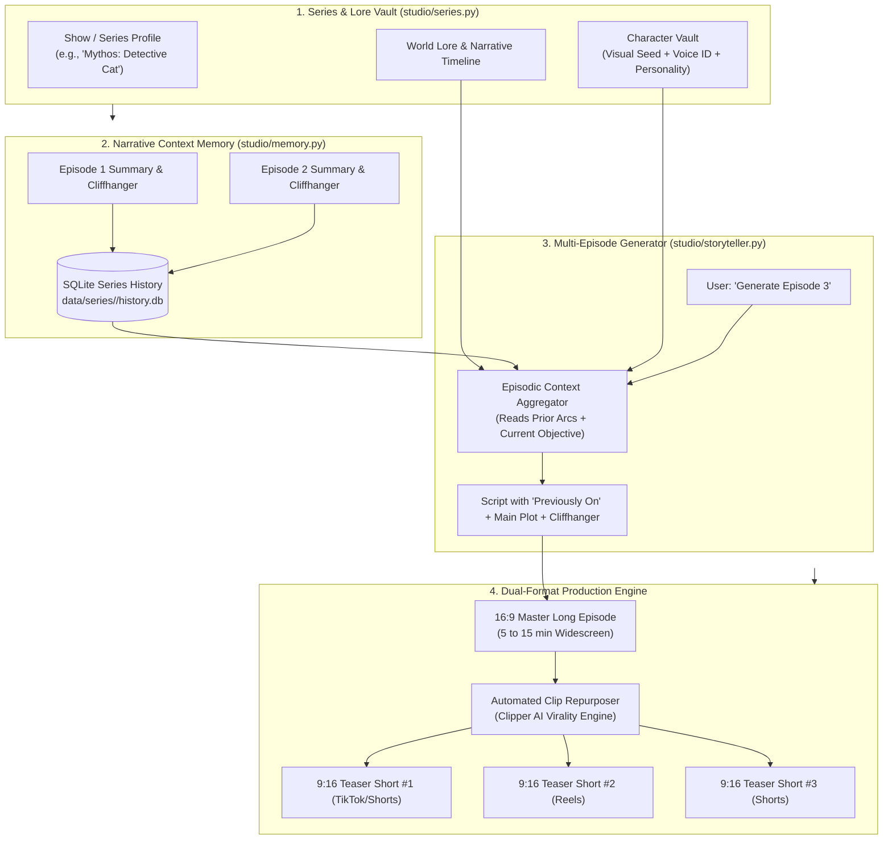
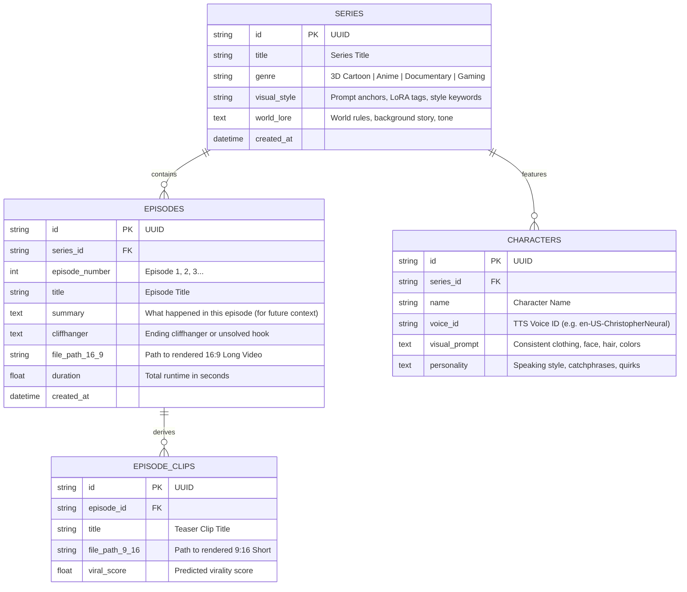

# Engineering Plan 06 — Episodic Series Engine & Narrative Continuity Memory

> **Plan ID**: `PLAN-06`  
> **Status**: **Approved (Strategic Master Blueprint)**  
> **Target Modules**: `studio/series.py` (New), `studio/memory.py` (New), [`studio/db.py`](file:///E:/YouTube/Automation/Clipper/studio/db.py), [`studio/storyteller.py`](file:///E:/YouTube/Automation/Clipper/studio/storyteller.py), [`studio/jobs.py`](file:///E:/YouTube/Automation/Clipper/studio/jobs.py), [`web/index.html`](file:///E:/YouTube/Automation/Clipper/web/index.html)  
> **Estimated Effort**: 8 Days  

---

## 1. Executive Summary & Vision

This plan represents the ultimate culmination of the content automation studio: **The Episodic Series & Multi-Format Production Engine**.

Instead of isolated, one-off videos, the system allows creators to establish **ongoing recurring Shows & Series** (e.g., *"The Cyberpunk Detective — Season 1"*, *"History Uncovered — Episodes 1 to 10"*, *"Daily Stream Highlights Weekly Show"*).

### Core Capabilities:
1. **Multi-Episode Story Arc & Context Memory**:
   - Generates multi-episode story arcs where Episode $N$ remembers the plot, events, character choices, and cliffhangers from Episodes $1 \dots N-1$.
   - Automatically writes *"Previously on..."* recaps at the start of new episodes and *"Next time on..."* cliffhangers at the end.
2. **Character & Aesthetic Consistency Vault**:
   - Stores persistent character profiles (visual appearance, clothes, facial style, voice ID, personality) so characters look and sound identical across all episodes.
3. **Universal 4-Mode Content Ingestion**:
   - **Mode A (Link-Based)**: Ingest YouTube, Twitch VOD, Kick, or MP4 $\to$ extract clips $\to$ compile into a weekly highlights show.
   - **Mode B (Live Stream-Based)**: Ingest 24/7 Twitch/YouTube Live $\to$ real-time spike clipping.
   - **Mode C (Story / Prompt-Based)**: Text prompt $\to$ 3D Cartoon / Anime multi-scene long-form episode.
   - **Mode D (Episodic Continuation)**: *"Continue Series"* prompt $\to$ reads prior episodes $\to$ writes the next chapter.
4. **Automated Long-to-Short Cross-Repurposing (The Flywheel)**:
   - When a long-form 16:9 episode is completed, Clipper automatically passes the episode through its viral clipping pipeline to generate **3 to 5 vertical 9:16 teaser shorts** with a *"Full Episode on our channel"* end-card, automating multi-platform distribution.

---

## 2. Episodic Production Architecture



---

## 3. Database Schema Extensions in `studio/db.py`

To support episodic continuity and series management, we introduce three relational tables:



---

## 4. Narrative Context Memory Engine (`studio/memory.py`)

When generating Episode $N$, the memory engine prepares an injected system prompt for Gemini:

```python
# Conceptual Memory Aggregator in studio/memory.py
def build_series_prompt(series_id: str, episode_num: int, episode_goal: str) -> str:
    series = db.get_series(series_id)
    characters = db.get_characters(series_id)
    history = db.get_prior_episodes(series_id, limit=5)
    
    context = f"""
    You are the showrunner for the animated series: "{series.title}".
    Genre: {series.genre}
    Visual Aesthetic: {series.visual_style}
    World Lore: {series.world_lore}
    
    RECURRING CHARACTERS:
    {format_characters(characters)}
    
    PREVIOUS EPISODE RECAP:
    {format_episode_summaries(history)}
    
    CURRENT TASK:
    Write the complete script for EPISODE {episode_num}.
    Objective: {episode_goal}
    
    REQUIREMENTS:
    1. Start with a 15-second 'Previously on {series.title}' recap referencing the last episode's cliffhanger.
    2. Maintain character relationships and inside jokes established in prior episodes.
    3. Conclude with a dramatic cliffhanger or intriguing mystery for the next episode.
    """
    return context
```

---

## 5. Visual Character Consistency Strategy

Achieving consistent character design across episodes in 3D Cartoon / Anime styles:

1. **Character Visual Anchor Prompt**:
   Every scene involving a character prepends their strict visual blueprint:
   `"Leo the Cat Detective: orange tabby cat, wearing a miniature brown trench coat, green eyes, expressive Pixar style 3d render, vibrant studio lighting"`
2. **Seed & Reference Lock**:
   - Each character has a locked base image in `data/series/<series_id>/characters/<name>.png`.
   - In generative pipelines (ComfyUI / Midjourney / Flux IP-Adapter), this image acts as the identity reference input for all generated frames.

---

## 6. The Automated Flywheel: Long Video $\to$ Promotional Shorts

A complete YouTube content empire relies on a two-tier publishing model:

```
+--------------------------------------------------------------------------------+
|  STEP 1: Full 16:9 Episode (YouTube Long-Form)                                 |
|  - 8-Minute 3D Cartoon Episode: "The Cyberpunk Detective: Episode 3"           |
|  - Complete narrative with music, SFX, and high-DPI horizontal visuals         |
+--------------------------------------------------------------------------------+
                                       |
                                       v  (Automated Clipper Ingest)
+--------------------------------------------------------------------------------+
|  STEP 2: Automated 9:16 Teaser Shorts (TikTok / IG Reels / Shorts)             |
|  - Teaser #1: The Intense Opening Mystery Hook (45s)                          |
|  - Teaser #2: The Funny Character Moment (30s)                                 |
|  - Teaser #3: The Final Cliffhanger Ending (40s)                               |
|  * All rendered with Hormozi captions & end-screen: "Watch Full Ep 3 on YT!"   |
+--------------------------------------------------------------------------------+
```

---

## 7. Master Implementation Roadmap

- [ ] **Milestone 1: Database & Series Schema (`studio/db.py`)**
  - Implement `Series`, `Characters`, `Episodes`, and `EpisodeClips` tables.
- [ ] **Milestone 2: Memory & Context Aggregator (`studio/memory.py`)**
  - Implement episodic history logging and multi-turn prompt compilation.
- [ ] **Milestone 3: Character Vault UI (`web/index.html`)**
  - Series & Character creation interface in the web dashboard.
- [ ] **Milestone 4: Dual-Format Rendering Pipeline**
  - Connect `studio/storyteller.py` (16:9) with `studio/jobs.py` (9:16) for automatic cross-repurposing.
