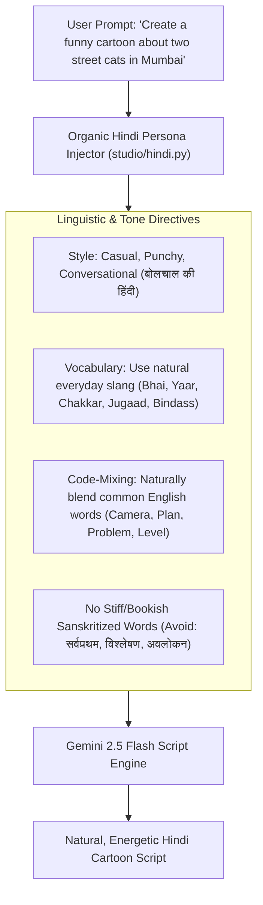

# Engineering Plan 07 — Organic Hindi Language Models, Voiceover & Devanagari Typography

> **Plan ID**: `PLAN-07`  
> **Status**: **Approved (Language & Cultural Adaptation Blueprint)**  
> **Target Modules**: `studio/hindi.py` (New), `studio/tts.py` (New), [`studio/roman.py`](file:///E:/YouTube/Automation/Clipper/studio/roman.py), [`studio/brain.py`](file:///E:/YouTube/Automation/Clipper/studio/brain.py), [`studio/render.py`](file:///E:/YouTube/Automation/Clipper/studio/render.py)  
> **Estimated Effort**: 3 Days  

---

## 1. Executive Summary & Goals

Standard AI translations into Hindi typically produce stiff, robotic, formal Sanskritized phrasing (e.g., *"सर्वप्रथम हम इस घटना का विश्लेषण करेंगे"*). This sounds completely unnatural in entertainment, gaming videos, and 3D animated cartoon storytelling.

The goal of this plan is to build an **Organic, Conversational Hindi & Hinglish Engine** that sounds lively, natural, culturally authentic, and expressive (बोलचाल की हिंदी / Hinglish).

### Core Capabilities:
1. **Colloquial Hindi LLM Prompt Engine**:
   - Instructs Gemini 2.5 Flash to write cartoon scripts, character dialogues, and narration in natural conversational Hindi with natural code-mixing (words like *"Bhai"*, *"Yaar"*, *"Scene"*, *"Gajab"*, *"Plan"*, *"Panga"*).
2. **Expressive Hindi Neural Voiceover (TTS)**:
   - Integrates high-fidelity Indian neural voices via `edge-tts`:
     - **`hi-IN-MadhurNeural`**: Deep, warm, animated male voice (perfect for storytelling, cartoon heroes, dramatic narrations).
     - **`hi-IN-SwaraNeural`**: Energetic, expressive female voice (great for children, sidekicks, comedic cartoon characters).
   - Character pitch and speed modulations for cartoon voice effects (e.g. high-pitch cartoon squeak, deep cartoon villain).
3. **Dual Subtitle Mode (Devanagari vs. Hinglish)**:
   - Option A: **Devanagari Script** (`हिंदी`) using bold cartoon fonts like **Modak** or **Noto Sans Devanagari Bold**.
   - Option B: **Roman Hinglish** (e.g., *"Yeh banda alag hi level pe khel raha hai!"*) powered by [`studio/roman.py`](file:///E:/YouTube/Automation/Clipper/studio/roman.py).
4. **Multilingual ASR Adaptation**:
   - Accurately transcribes Hindi & Hinglish audio from Indian creators (Fukra Insaan, CarryMinati, Total Gaming) with word-level timestamps.

---

## 2. Organic Hindi Prompt Architecture (`studio/hindi.py`)

To ensure the AI generates authentic Hindi rather than textbook translations, we enforce strict linguistic rules in `studio/brain.py`:



### System Prompt Specification:
```python
ORGANIC_HINDI_SYSTEM_PROMPT = """
You are an expert scriptwriter for Hindi animated cartoons and viral shorts.
LANGUAGE DIRECTIVES:
1. Write in natural, modern, conversational Hindi (बोलचाल की हिंदी) as spoken in Delhi/Mumbai/North India.
2. DO NOT use formal, bookish, or Sanskritized Hindi (e.g. do not say 'अवलोकन', 'प्रयास', say 'dekhna', 'koshish').
3. Freely code-mix standard English loanwords that everyday Hindi speakers use naturally (e.g., 'boss', 'plan', 'time', 'tension', 'problem', 'ready').
4. Include natural emotional interjections and comedic timing (e.g., 'Arre bhai!', 'Ab dekh maza!', 'Kasam se yaar!').
5. Output dialogue with emotional cues for the voice actor: [Excited], [Whispering], [Shocked], [Laughing].
"""
```

---

## 3. Neural Voice Models & Cartoon Pitch Modulation

### 3.1. Voice Roster
| Voice Identifier | Gender | Tone & Personality | Best Used For |
| :--- | :---: | :--- | :--- |
| **`hi-IN-MadhurNeural`** | Male | Deep, confident, warm, cinematic | Hero characters, main narrator, story leads |
| **`hi-IN-SwaraNeural`** | Female | Bright, clear, lively, emotional | Female characters, kid characters, enthusiastic sidekicks |
| **`hi-IN-MadhurNeural (Pitch +25Hz)`** | Male | Squeaky, comical, fast-paced | Funny animal cartoon characters |
| **`hi-IN-MadhurNeural (Pitch -20Hz)`** | Male | Grumbly, heavy, intimidating | Cartoon villains, grumpy mentors |

### 3.2. Voice Generation Code with Pitch & Speed Modifiers
```python
# In studio/tts.py
import edge_tts

async def generate_hindi_cartoon_voice(
    text: str, 
    out_wav: str, 
    voice: str = "hi-IN-MadhurNeural",
    pitch: str = "+0Hz",    # e.g., "+20Hz" for cartoon squeak, "-15Hz" for deep voice
    rate: str = "+5%"       # +5% for energetic pacing
):
    communicate = edge_tts.Communicate(text, voice, pitch=pitch, rate=rate)
    await communicate.save(out_wav)
```

---

## 4. Devanagari Cartoon Typography & Font Engine

Subtitles in Hindi require specialized font rendering to ensure compound conjuncts (संयुक्त अक्षर जैसे *क्ष, त्र, ज्ञ, स्त*) render cleanly without breaking apart in FFmpeg.

### 4.1. Bundled Hindi Fonts in `studio/fonts/`:
1. **`NotoSansDevanagari-Bold.ttf`** *(Already present in repository)*: Clean, ultra-crisp modern sans-serif.
2. **`Modak-Regular.ttf`** *(To be added)*: Ultra-thick, bouncy, bubble-style Devanagari cartoon font (the quintessential Pixar/Disney Hindi aesthetic).
3. **`Poppins-Black.ttf`** *(Already present)*: Perfect for Hinglish Roman text.

### 4.2. Dual Subtitle Selection in Web Dashboard
Creators can pick their subtitle script:
- `Script: [ Devanagari (हिंदी) v ]` $\to$ Renders with `Modak` bubble font + yellow outline.
- `Script: [ Roman Hinglish v ]` $\to$ Automatically transliterates Devanagari via `studio/roman.py` into natural chat-style English letters (*"Bas yahi same position chahiye?"*).

---

## 5. Implementation Roadmap Checklist

- [ ] **Step 1**: Add `ORGANIC_HINDI_SYSTEM_PROMPT` and colloquial filters into `studio/brain.py`.
- [ ] **Step 2**: Add `hi-IN-MadhurNeural` and `hi-IN-SwaraNeural` voice profiles into `studio/tts.py`.
- [ ] **Step 3**: Download and add `Modak-Regular.ttf` into `studio/fonts/` for bouncy Hindi cartoon typography.
- [ ] **Step 4**: Add Hindi language selector to the web dashboard (`[x] Language: Hindi / Hinglish`).
- [ ] **Step 5**: Test script generation and voice rendering on a 60-second Hindi cartoon teaser.
