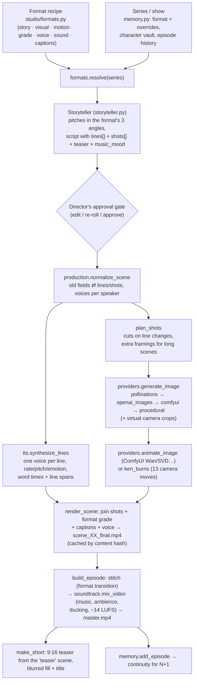

# Engineering Plan 08 — Universal AI Video Generation Engine (any genre, 2D / 3D / photoreal)

> **Plan ID**: `PLAN-08`
> **Status**: **In Development** (Phase A built and tested; B–D are the roadmap)
> **Builds on**: Plan 05 (episodic 3D engine), Plan 06 (series memory), Plan 07 (Hindi voice)
> **Modules**: `studio/formats.py` (new), `studio/providers.py` (new), `studio/production.py` (new),
> `studio/soundtrack.py` (new), `studio/tts.py`, `studio/storyteller.py`, `studio/series.py`, `studio/memory.py`,
> `studio/visuals.py`, `studio/server.py`, `web/index.html`, `tests/test_production.py` (new)

---

## 1. Why

Plan 05 produced one kind of video: a "3D cartoon" where each scene was **one picture, one speaker, one voice**,
silent behind the dialogue, with the style written into prompts by hand. The goal is a studio that makes **any**
kind of video: horror, anime, 2D cartoons, 3D kids shows, documentaries, true crime, bedtime stories, motivational
shorts and more. That takes more than a new style string. Every stage has to know what kind of video it is making.

**Core idea: a video *Format* is a complete production recipe.** Choosing "Horror Story" changes the story rules,
the voices, the picture style, the camera, the colour grade, the music, the captions and the pacing, all together.
Adding a new kind of video is one entry in `studio/formats.py`.

---

## 2. Architecture

---

## 3. What each new module does

### 3.1 `studio/formats.py`: the format registry (20 formats)

| Category | Formats |
|---|---|
| Kids & Family | 3D Kids Cartoon, 3D Family Film, 2D Cartoon, Bedtime Story (watercolor) |
| Anime & Stylised | Anime, Retro Pixel Art, Clay / Stop-Motion |
| Horror & Thriller | Horror Story, Scary Story Narration, Mystery Thriller, Noir (B&W) |
| Documentary & Education | History Documentary, True Crime, Facts & Explainer, Mythology Epic |
| Cinematic Fiction | Sci-Fi, Fantasy Epic, Cinematic Drama, Comedy Sketch |
| Faceless Channels | Motivational / Stoic (9:16 by default) |

Each entry holds:
- `story`: tone rules, narrated / dialogue / mixed, structure beats, the 3 pitch angles, typical scene length
- `visual`: style DNA added to every image prompt, plus a negative prompt
- `motion`: camera moves, seconds per shot, transition between scenes (fade / fadeblack / cut)
- `grade`: FFmpeg colour grade (horror: desaturated, cold, vignette, grain; noir: black and white; anime: punchy)
- `voice`: narrator voice per language, speaking rate and pitch (horror: −8 %, −4 Hz)
- `sound`: music mood, ambience bed, music level
- `captions`: caption template and position

A series stores `format` plus optional `format_overrides`. `formats.resolve()` merges them. Old series without a
format are guessed from their genre and style (`formats.guess`), so nothing existing breaks.

### 3.2 `studio/providers.py`: pluggable picture and motion services

| Kind | Provider | Setup |
|---|---|---|
| Image | `pollinations` (default) | free; 1 image / ~45 s per IP. Spaced automatically; `PEAKCUT_POLLINATIONS_KEY` lifts the limit |
| Image | `openai_images` | any OpenAI-compatible `/images/generations` (`PEAKCUT_IMAGE_API_*`) |
| Image | `comfyui` | local GPU, API-format workflow JSON with `{{prompt}} {{negative}} {{width}} {{height}} {{seed}}` |
| Image | `procedural` | always last, so a video always finishes |
| Motion | `kenburns` (default) | local FFmpeg camera moves |
| Motion | `comfyui` | image-to-video (Wan 2.x / CogVideoX / SVD / AnimateDiff) with `{{image}} {{frames}} {{fps}}` |

All images are cover-cropped to the exact frame (no more stretched squares) and seeded from series, episode,
scene and shot, so re-renders are stable. **Virtual camera**: extra framings of a long scene (medium, close-up,
detail…) are cut from the scene's own picture, so the free tier is not spent on them
(`PEAKCUT_NEW_IMAGE_PER_FRAMING=1` makes real new pictures instead).

### 3.3 `studio/production.py`: script to finished video

- **Scene model v2**: `lines[]` (speaker, text, emotion → own voice) and `shots[]` (visual_prompt, camera_motion).
  Old scenes (`speaker` / `dialogue` / `visual_prompt`) are converted automatically, including `"Name: line"`
  dialogue. If the creator edits the old fields in the script editor, the edit wins.
- **Shot timing follows the speech**: with one shot per line, cuts land on line changes. Long scenes get extra
  framings instead of one frozen picture for a minute.
- **Scene duration = voice length + 0.7 s.** Plan 05 padded every scene to ~55 s, which left silent dead air.
- **13 camera moves** with smoothstep easing and 2× supersampling: dolly in/out, pan, tilt, zoom punch, creep,
  drift, shake (horror), static.
- **One FFmpeg pass per scene**: join shots → format grade → captions (Hindi uses the Devanagari font) → voice.
- **Content-hash cache**: re-rolling one scene re-renders only that scene.

### 3.4 `studio/soundtrack.py`: music, ambience, mix

13 music moods and 4 ambience beds. Your own tracks in `<data>/music/<mood>/` are used first. Otherwise a
seamless loop is synthesised locally with numpy (no downloads, no licences). The mix ducks the music under
dialogue (sidechain) and normalises to **−14 LUFS**.

### 3.5 Changes to existing modules

- `tts.py`: rate, pitch and emotion prosody per line; `synthesize_lines()`; gender-aware `pick_voice()` so every
  character sounds different. **Bug fixed**: word times drifted earlier on long scenes because each chunk's
  offset used the last word's end time instead of the real audio length.
- `storyteller.py`: prompts carry `formats.story_brief()`; pitches use the format's own 3 angles; the script
  schema adds `lines`, `shots`, `teaser` and `music_mood`. The canned farm fallback is used only for kids formats;
  other formats report that the AI is needed (HTTP 503).
- `series.py`: the render loop is replaced by `production.build_episode`. New characters get a look in the
  series' style and a distinct, gender-appropriate voice.
- `visuals.py`: `generate_scene_frame` goes through the provider chain. **Bug fixed**: avatars asked for 1:1
  but got 1080×1920 stretched images.
- `server.py`: `GET /api/studio/formats`, `GET /api/studio/providers`; `POST /api/series` accepts `format` and
  gives seeded characters distinct voices.
- `web/index.html`: a **Video Format** picker in the New Series dialog fills in genre, style DNA and aspect ratio.

---

## 4. Roadmap

### Phase B: one-off videos and Studio home (UI)
- [ ] "Make a video" on the Studio home: prompt + format + length → script → approve → render, with no series
      setup (an auto-created one-episode show, `kind: "oneoff"`).
- [ ] Show the format chip, its music and its grade on the series page; let creators change the format of an
      existing series (`PUT /api/series/{id}` already accepts `format`, `format_overrides`).
- [ ] Script editor v2: edit `lines[]` (speaker dropdown, emotion) and `shots[]` (prompt, camera move,
      re-generate one picture) directly.
- [ ] Settings → AI Studio: provider status from `/api/studio/providers`, ComfyUI test button.

### Phase C: real animation tiers
| Tier | What moves | How |
|---|---|---|
| T0 (built) | camera over stills | `ken_burns` + virtual camera |
| T1 | characters' mouths and eyes on stills | lip-sync on a character layer (SadTalker / LivePortrait via ComfyUI); a background-removed character over a separate background plate for true parallax |
| T2 | full AI motion per shot | `comfyui` video provider with Wan 2.x img2vid (workflow JSON in `workflows/`); hosted fallbacks (fal.ai / Replicate / Runway / Kling) as new `VIDEO_PROVIDERS` entries |
| T3 | real 3D | Three.js / Blender headless with rigged GLB characters per series; same shot list drives the camera |

### Phase D: quality and consistency
- [ ] Character reference images: use each character's avatar as an IP-Adapter / reference image in ComfyUI
      workflows so faces stay identical between shots.
- [ ] Sound effects layer: `sfx[]` per scene (door creak, thunder, footsteps) from a local library, placed by time.
- [ ] Multiple shorts per episode (3–5 teasers) through the existing clip pipeline (Plan 06 flywheel).
- [ ] GPU encoding (NVENC / QSV) for the scene pass (Plan 02).

---

## 5. Verification

- `python tests/test_production.py` (also part of `python tests/run.py`) runs offline in about 2 minutes:
  formats, legacy-script conversion, editor-edit precedence, prompt building, shot timing, the Pollinations
  free-limit retry, virtual camera, all 13 camera moves, all music moods and ambiences, and a complete horror and
  kids episode (master 1920×1080 with sound, 9:16 short, scene cache).
- Live check (done 2026-11-27): a two-scene horror episode through `POST /api/series/{id}/episodes/1/approve`
  with real edge-tts voices and Pollinations pictures produced the master and the short.
