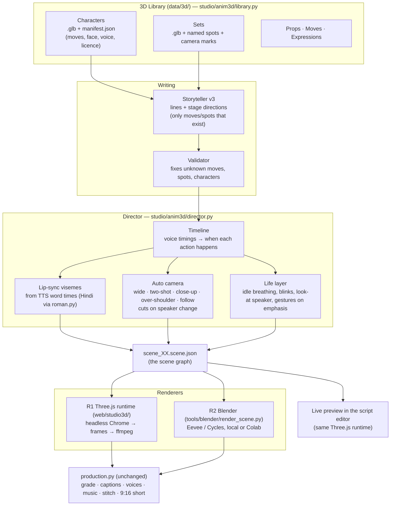

# Engineering Plan 09 — Real 3D Animation Engine (animated characters, animated worlds)

> **Plan ID**: `PLAN-09`
> **Status**: **In Development**: the core (P0 + P1) is built and is the default for every generated video
> **Builds on**: Plan 08 (formats, providers, production engine), Plan 06 (series memory), Plan 07 (Hindi voice)
> **New modules**: `studio/anim3d/` (library, director, renderers), `web/studio3d/` (Three.js runtime),
> `tools/blender/` (Blender renderer), `tools/colab/` (free-GPU notebooks)
> **Estimated effort**: about 4 weeks in 6 phases. Each phase ships something usable.

---

## 1. Goal

**No more flat scenes.** Every episode PeakCut makes for an animated format must show **characters that move,
talk, react and act inside a living 3D world**: walking, running, jumping, waving, lip-sync, blinking, facial
expressions, a moving camera with real cuts. The benchmark is a TV 3D cartoon (e.g. the *Masha and the Bear*
look), made with **our own original characters**, **for free**, **on this laptop**.

What we have today (Plan 08) is "one AI picture per shot + a camera move over it". It suits narrated formats
(horror narration, documentaries, motivational) and stays for them. It can never give moving characters, because
the picture itself never moves.

## 2. Decision: one scene description, three renderers

Real animated series are made with rigged 3D characters animated in a 3D set. We do the same, and keep the
renderer swappable:

| Renderer | What it is | Look | Speed on this laptop | Cost | Role |
|---|---|---|---|---|---|
| **R1 Three.js** | WebGL in headless Chrome (already installed) | clean, bright 3D cartoon; toon or soft shading, shadows, bloom | **measured: 14.8 frames/s at 1280×720** (Intel UHD 620) → ~8 min per 5-min episode | free | **default**, plus live preview inside PeakCut |
| **R2 Blender** | `blender -b` (Eevee / Cycles) from a script | premium: soft global light, fur, depth of field: the "Masha" richness | slow here (hours per episode, to be measured); fast on a free Colab GPU | free | "Premium render" button for hero episodes |
| **R3 AI enhance** (optional, later) | video-to-video restyling of the R1/R2 render (Wan/LTX on Colab, or paid Omni Flash) | adds painterly or photoreal finish while keeping the motion | GPU needed | free on Colab / paid | finishing pass |

The key rule: **R1 and R2 read the same scene file and the same `.glb` characters.** A scene previewed in the
browser renders identically in Blender, only nicer. Nothing is locked to one renderer.

Measured on 2026-11-28: a test scene (forest, two rigged robots walking, waving, jumping, face morph, camera
dolly and cut) rendered to MP4 by headless Chrome at 14.8 frames/s using the laptop's Intel graphics.

## 3. Architecture



## 4. Components

### 4.1 3D library — `data/3d/` + `studio/anim3d/library.py`
```
data/3d/
  characters/<id>/model.glb, manifest.json, thumb.jpg, turntable.mp4
  sets/<id>/set.glb, manifest.json   (spots, camera marks, lighting preset, sky, ambience)
  props/<id>/model.glb
  moves/<name>.glb                    (shared animation clips for a rig type, e.g. Mixamo humanoid)
```
Character `manifest.json`:
```json
{
  "id": "bhalu", "name": "Bhalu", "rig": "quadruped_bear | humanoid_mixamo | custom",
  "height_m": 1.9,
  "moves": {"idle": "Idle", "walk": "Walk", "run": "Run", "wave": "Wave", "jump": "Jump",
            "sit": "Sit", "laugh": "Laugh", "point": "Point", "dance": "Dance", "fall": "Fall"},
  "face": {"type": "morph | bones | texture",
           "visemes": {"A": "mouthOpen", "E": "mouthWide", "O": "mouthRound", "M": "mouthClosed", "F": "mouthF"},
           "blink": "eyesClosed",
           "emotions": {"happy": "smile", "sad": "sad", "surprised": "surprised", "angry": "angry"}},
  "voice": {"id": "hi-IN-MadhurNeural", "rate": "-4%", "pitch": "-6Hz"},
  "licence": {"name": "CC-BY 4.0", "credit": "…", "source": "https://…"}
}
```
A series character in the Character Vault gets `model_3d: "<library id>"`. Its avatar becomes a real render of
the model, so the vault shows exactly who appears on screen.

**Where characters come from** (all free):
1. **Ready packs**: CC0 animated animals and people (Quaternius, Kenney), Blender Studio CC-BY rigs with facial
   controls (Rain, Snow, Sprite, Ellie; credit line in the end card).
2. **Mixamo**: free auto-rig plus hundreds of moves for humanoid characters (royalty-free in videos).
3. **Procedural toon builder** (`studio/anim3d/toon_builder.py`): PeakCut builds cute stylised characters from
   shapes (round body, big eyes, ears, snout, clothes, colours) with a ready rig, face morphs and moves. The AI
   describes a character, the builder makes it, so there are **unlimited new characters, fully automatic**.
4. **Your own design → 3D**: a character picture to a 3D model once on a free Colab GPU (TRELLIS.2 / Hunyuan3D,
   `tools/colab/image_to_3d.ipynb`), then rigged with Mixamo (humanoids) or the toon builder's rig.

### 4.2 Scene graph — `scene_XX.scene.json`
The one file every renderer reads:
```json
{
  "set": "autumn_forest", "time_of_day": "morning", "weather": "clear", "fps": 24, "duration": 18.4,
  "cast": [{"id": "bhalu", "spot": "log"}, {"id": "mini", "spot": "path_left"}],
  "actions": [
    {"t": 0.0, "who": "mini", "do": "run_to", "target": "log"},
    {"t": 2.1, "who": "bhalu", "do": "sit"},
    {"t": 3.0, "who": "mini", "do": "jump"},
    {"t": 3.4, "who": "bhalu", "emotion": "surprised", "for": 1.2}
  ],
  "speech": [{"who": "mini", "start": 4.0, "end": 6.3, "visemes": [[4.02, "M"], [4.10, "A"], "…"]}],
  "look_at": [{"t": 4.0, "who": "bhalu", "at": "mini"}],
  "camera": [{"t": 0.0, "shot": "wide", "move": "dolly_in"},
             {"t": 4.0, "shot": "closeup", "on": "mini"},
             {"t": 6.4, "shot": "two_shot", "on": ["mini", "bhalu"]}],
  "props": [{"id": "honey_pot", "at": "log_top"}]
}
```

### 4.3 Storyteller v3 (stage directions)
For animated formats the script gains `directions` per scene, written **only from what the library has**: the
prompt lists each character's moves and expressions and each set's spots. `studio/anim3d/validate.py` repairs
the rest: an unknown move maps to the nearest one (`sprint → run`), an unknown spot maps to the nearest free spot,
and an unknown character is created by the toon builder. The old fields (`lines`, `shots`) keep working, so the
script editor and the image pipeline are untouched.

### 4.4 Director — `studio/anim3d/director.py`
Turns lines plus directions into the scene graph, so the AI only has to say *what happens*, never frame by frame:
- **Timing**: anchors actions to voice timings (`tts.synthesize_lines` spans and word times).
- **Lip-sync**: visemes from the TTS word times. Each word's letters map to mouth shapes spread across the word;
  Hindi goes through `roman.py` first. Mouths close in pauses.
- **Life layer**: idle breathing, blinks every 2–5 s, eyes and head turning to whoever speaks, small gestures on
  emphasised words, weight shifts. This is what stops characters looking like statues.
- **Auto camera**: wide for establishing, close-up on the speaker, two-shot for exchanges, over-the-shoulder for
  conversation, follow shots for movement. It cuts on speaker change, never cuts faster than 1.5 s, and keeps the
  180° rule.
- **Blocking**: walking paths between spots, with no characters overlapping.

### 4.5 R1 Three.js runtime — `web/studio3d/`
- One ES module runtime: `loadScene(sceneGraph)`, `renderAt(t)` (deterministic, frame-exact), `play()` for
  preview. Three.js and add-ons are vendored into `web/studio3d/vendor/` (no CDN at render time).
- Look: ACES tone mapping, soft shadows, sky and fog per set, hemisphere + sun light presets, optional toon
  outline shader, bloom, depth of field and SSAO via post-processing.
- **Render worker** `studio/anim3d/render_threejs.py`: starts headless Chrome (the same DevTools method as the
  test), steps frames, pipes JPEGs to ffmpeg. It returns a silent clip to `production.render_scene`, which adds
  grade, captions and voice as today.
- The **same runtime** powers the live preview player in the script editor.

### 4.6 R2 Blender — `tools/blender/render_scene.py`
- `blender -b --python render_scene.py -- scene.json out.mp4`. It imports the same `.glb` files, rebuilds the
  timeline from the same scene graph, and uses Eevee by default (Cycles for top quality).
- Blender-only extras: fur and hair, cloth, volumetric light, real depth of field.
- Optional `tools/colab/blender_render.ipynb` renders on a free GPU and is picked up by PeakCut as a remote
  worker.
- PeakCut finds Blender in the default install folder or at `PEAKCUT_BLENDER`. When Blender is missing, the
  Premium button explains how to install it.

### 4.7 PeakCut integration
- **Formats**: new `render: "anim3d"` field. Animated formats (3D Kids Cartoon, 3D Family Film, Anime-3D, Comedy,
  Fantasy…) use the 3D engine; narrated formats keep stills + camera motion. New format: **"3D Animated Series"**.
- `production.render_scene`: `if fmt["render"] == "anim3d": clip = anim3d.render(scene_graph, renderer)`. Voices,
  captions, grade, music, stitching, shorts and the scene cache stay as they are.
- `renderer` per episode: `threejs` (default) or `blender` (premium), chosen in the approval gate.
- Render progress reports frames, for example "Scene 3/8 · frame 214/441".

### 4.8 UI
- **Character Vault 3D**: turntable preview, "choose model" gallery (library + toon builder + import `.glb`),
  list of moves and expressions, voice. "Create with AI" builds a toon character from a description.
- **Set library**: gallery of sets with their spots.
- **Script editor**: each scene shows the dialogue and a **stage directions table** (time, who, action, target,
  emotion), with dropdowns limited to what the character can do, and a **live 3D preview** player for the scene.
- **Approval gate**: renderer choice (Fast 3D / Premium Blender), an estimated render time, then render.

## 5. Phases

| Phase | Deliverable | Effort | Done when |
|---|---|---|---|
| **P0 Proof in the app** | `data/3d/` with 1 set + 2 characters, scene-graph format, Three.js runtime, headless render worker | 2–3 days | a hand-written 20 s scene renders to MP4 inside PeakCut with voices + captions + music |
| **P1 Director + writer** | timeline, lip-sync, life layer, auto camera, Storyteller v3 directions + validator, "3D Animated Series" format wired into `production.py` | 4–5 days | "Approve" on an AI-written episode produces a fully animated 3D episode, no hand edits |
| **P2 Studio UI** | Vault 3D, set library, stage-direction editor, live preview, renderer choice | 4 days | every scene can be previewed and corrected in the app before rendering |
| **P3 Characters for everyone** | procedural toon builder, `.glb`/Mixamo import, image-to-3D Colab notebook, 10+ starter characters and 6+ sets | 4–5 days | a new series can get its own original cast in minutes |
| **P4 Premium renderer** | Blender script, same output, Colab GPU notebook | 3–4 days | the same episode renders in Blender with richer light, and fur on supported characters |
| **P5 Polish** | toon/anime shaders, crowds, weather and particles, vehicles and props, R3 AI-enhance pass | ongoing | — |

## 5b. Built so far (2026-11-28)
- `web/studio3d/runtime.js` + vendored Three.js r160: 8 worlds (green and autumn forest, farm, village, beach, snow,
  night, room, space), 4 moods (day, sunset, night, dark), and a toon builder for humans (child, adult, old; caps,
  turbans, crowns, fedoras, glasses, bows), 22 animal kinds, robots and critters. It handles walk-ins, talking
  gestures, lip-sync, blinking, breathing, look-at, wave, jump, bounce, nod, point, shrug, think, dance, look-around,
  and the emotions happy, sad, angry, scared and surprised. The auto camera does establishing, close-up,
  over-the-shoulder, two-shot, wide and pull-back shots.
- `studio/anim3d/characters.py` (vault entry → design, English and Hindi, colours bound to parts), `director.py`
  (scene + voice timings → spec) and `worker.py` (headless Chrome/Edge → ffmpeg).
- `production.render_scene` renders every scene in 3D by default and falls back to pictures when no browser is
  available. The scene cache follows the designs and the runtime.
- Character Vault portraits are rendered from the 3D characters.
- `tts.cast_voice`: a voice per character matched to who they are, with its own pitch and speed, so Hindi's two
  voices still give every character a different sound.
- Storyteller prompts ask for an emotion on every line and a plain-word setting.
- Measured: a 34 s Hindi episode (2 scenes, 3 characters) rendered end to end through the API in about 2 minutes
  on this laptop.
- Not yet built: the Phase P2 UI (stage-direction editor, live preview), P3 (`.glb` import, image-to-3D), P4 (Blender).


### Any kind of character (added later)

Characters are no longer limited to a fixed list. Four bodies (human, animal, robot, blob) plus parts make any
character: `web/studio3d/parts.js` has 72 parts (helmets, caps, crowns, witch and wizard hats, capes, coats, robes,
gowns, sarees, wings, horns, halos, fish tails, shells, spikes, pads, boots, rags, ribs, wraps, masks…), 53 things to
hold (bat, sword, wand, staff, broom, trident, microphone, trophy, torch, magnifier… and every story prop), poses
(zombie, float, proud, hunched, hands on hips) and effects (ghostly, glowing, shadowy). Animals gained crocodile,
horse, zebra, unicorn, donkey, camel, snake, fish, shark, turtle, penguin, parrot, peacock, eagle, leopard, giraffe,
hen and dragon, with new snouts, tails and coat patterns.

Where a design comes from: the **AI designer** (`studio/concepts.py` `design_toons`) writes it once when a character
is created (new series, Add Character, AI suggestions, characters an episode introduces, Re-render 3D Look for older
ones) and stores it as the character's `toon`; `characters.clean_toon` keeps only what can be built. Without an AI,
the word rules (`ROLE_RULES`, `HELD`, `WORN`) cover about 45 common jobs and creatures. Tests:
`tests/test_characters.py`.

## 6. What stays as it is
- The image + camera-motion pipeline (Plan 08) for narrated formats: horror narration, documentaries, explainers,
  motivational. It is also the fallback if a 3D render fails.
- Voices, captions, colour grades, music and ambience, stitching, shorts, scene cache, series memory.

## 7. Risks and rules
- **Original characters only.** Animated formats must use original characters. The `chhota_bheem` format added
  to `studio/formats.py` names a real franchise (Chhota Bheem and its characters belong to Green Gold Animation).
  Publishing episodes with those names or that look can get videos and channels struck. Turn it into an original
  format (for example "Indian Village Hero Cartoon" with our own cast) before using it for uploads.
- **Asset licences**: each manifest records its licence and credit. CC-BY credits are added to the end card
  automatically. Packs with "no AI use" clauses are not imported.
- **Look quality depends on the characters.** Free packs are simple. Quality rises with the toon builder, better
  rigs, and the Blender renderer.
- **Lip-sync from word timings is approximate.** It is good for cartoons; exact phoneme sync can come later from a
  phoneme aligner.
- **Laptop limits**: 14.8 frames/s was a light scene. Heavy sets, 1080p and post effects will be slower. The
  render worker reports a time estimate before starting, and 720p is the default on this laptop.

## 8. Verification
- `tests/test_anim3d.py` (offline): manifest loading, validator repairs, director timing, viseme generation,
  camera rules (no cut under 1.5 s, cut on speaker change), scene-graph schema, and a headless render of a 3 s
  scene with frame count and resolution checks.
- Visual check per phase: frame grids of the rendered episode, as done for the 2026-11-28 test.
