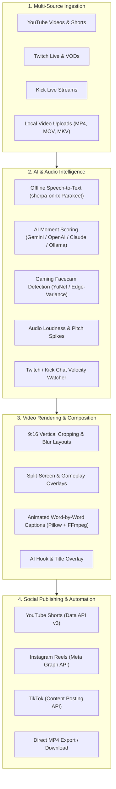

# Project Overview: Clipper (PeakCut)

## 1. Executive Summary

**Clipper** (built on the open-source PeakCut engine) is an autonomous, self-hosted AI video repurposing platform. It transforms long-form content—such as YouTube podcasts, interviews, gaming streams on Twitch and Kick, or raw video uploads—into viral, captioned 9:16 vertical clips engineered for **YouTube Shorts**, **Instagram Reels**, and **TikTok**.

Unlike closed commercial SaaS tools (such as OpusClip, Munch, or Klap) that charge monthly subscriptions and per-minute transcription fees, Clipper operates entirely under your control:
- **Local & Offline Speech-to-Text**: Speech transcription runs locally on your computer with `sherpa-onnx` and quantized NeMo models ($0 transcription cost, 100% private audio).
- **Bring Your Own Key (BYOK) for LLMs**: Connect directly to Google Gemini, OpenAI, Claude, Groq, Grok, OpenRouter, or completely free local models via Ollama.
- **Direct Multi-Platform Distribution**: Automated OAuth publishing pipeline with rate limiting, daily caps, and spaced scheduling.

---

## 2. Target Audience & Use Cases

| Audience | Core Pain Point | Clipper Solution |
|---|---|---|
| **Content Creators & Podcasters** | Editing 1–3 hour episodes into 10+ vertical shorts takes hours of manual scrub, crop, and caption work. | One-click ingestion from YouTube link; AI automatically extracts high-retention moments with word-by-word animated captions. |
| **Live Streamers (Twitch / Kick)** | Best stream moments happen live and require immediate publishing while trends are hot. | Real-time rolling buffer records live streams, detecting excitement via audio loudness peaks and chat velocity spikes. |
| **Clipping Agencies & Growth Marketers** | Managing multiple creators and social channels across TikTok, Shorts, and Reels is complex and expensive. | Multi-creator workspaces with dedicated posting rules, daily upload limits, and automated OAuth distribution. |
| **Developers & Privacy-Conscious Teams** | Unwilling to send proprietary or unreleased audio/video to third-party cloud clipping servers. | Self-hosted on local hardware or private Linux servers with zero external audio leaks. |

---

## 3. High-Level Capability Map

The following Mermaid diagram illustrates the end-to-end capabilities and functional domains of Clipper:

---

## 4. Key Competitive Advantages

1. **Zero Transcription Bills**:
   Commercial clipping services charge \$15–\$60/month based on hours transcribed. Clipper uses local ONNX-accelerated neural networks on your CPU, costing \$0 regardless of video length.
2. **Audio-Only LLM Costs**:
   A 1-hour video produces ~8,000 words of transcript. Sending this to Gemini 2.5 Flash costs less than **\$0.002** per hour of analyzed video.
3. **Dedicated Gaming Mode**:
   Standard clippers center-crop gaming videos, cutting off the streamer's facecam or critical HUD elements. Clipper isolates the webcam rectangle and pins it into the 9:16 gameplay canvas.
4. **Live Stream Snipping**:
   You do not need to wait for a 6-hour stream to finish. Clipper records live into rolling memory buffers and cuts clips on the fly as chat explodes.
5. **No Node.js / NPM Bloat**:
   Built cleanly on Python FastAPI with a vanilla HTML5/CSS3/JavaScript dashboard—zero webpack, vite, or node_modules headaches.
