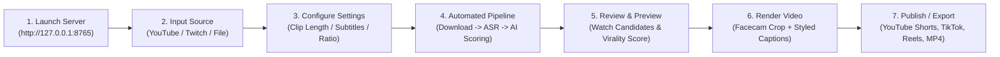

# Clipper — User Guide & Operational Manual

This guide provides an end-to-end operational manual for **Clipper**, from local startup and configuration to dashboard navigation, AI tuning, multi-platform OAuth connection, and job execution.

---

## 1. Prerequisites & Environment Check

Before launching Clipper, ensure the following core dependencies are installed and available in your environment:

| Dependency | Required Version | Verification Command | Description |
| :--- | :--- | :--- | :--- |
| **Python** | 3.10 to 3.13 | `python --version` | Runtime engine for FastAPI and processing pipeline |
| **FFmpeg & FFprobe** | 6.0+ (9.0 recommended) | `ffmpeg -version` | Audio/video demuxing, filtergraph rendering, layout composition |
| **Git** | 2.30+ | `git --version` | Version control and upstream fork synchronization |
| **AI API Key** | Google Gemini / OpenAI | Check `.env` file | Generative AI engine for transcript analysis and scoring |

> [!NOTE]
> On Windows, FFmpeg binaries must either be in your System `PATH` or explicitly configured via `PEAKCUT_FFMPEG_DIR` in your `.env` file (e.g., `PEAKCUT_FFMPEG_DIR=D:\Program Files\ffmpeg\bin`).

---

## 2. Launching Clipper Locally

Clipper provides multiple convenient ways to launch locally depending on your workflow.

### Method A: Single-Click Batch Launcher (Recommended)
In the root directory of the project, run:
```cmd
.\dev.bat
```
This batch script automatically:
1. Detects or creates the `.venv` virtual environment.
2. Verifies installed packages and installs any missing requirements from `requirements.txt`.
3. Verifies FFmpeg and FFprobe binary availability.
4. Starts the Uvicorn ASGI server with hot-reload enabled at `http://127.0.0.1:8765`.

### Method B: VS Code / Antigravity IDE (F5 Debugging)
Pre-configured VS Code settings have been created in `.vscode/`:
- Press **`F5`** to launch with interactive debugging and breakpoints.
- Or open the Command Palette (`Ctrl+Shift+P`) -> **Tasks: Run Task** -> **Run Clipper Dev Server**.

### Method C: Direct Shell Command
```bash
# Activate virtual environment
.\.venv\Scripts\activate

# Run Uvicorn directly
python -m uvicorn peakcut.server:app --host 127.0.0.1 --port 8765 --reload
```

---

## 3. End-to-End User Journey



---

## 4. Web Dashboard Walkthrough

Once the server is running, open your browser and navigate to:
```
http://127.0.0.1:8765
```

The user interface is lightweight, responsive, and completely dependency-free (pure HTML5, CSS3, and vanilla JavaScript).

```
+------------------------------------------------------------------------------------+
|  C L I P P E R                     [ Settings ]  [ Accounts ]  [ Server Status: OK]|
+------------------------------------------------------------------------------------+
|  [ + New Job ]   [ Feed / Clips ]   [ Live Monitor ]   [ Creators ]                |
+------------------------------------------------------------------------------------+
|                                                                                    |
|  Source Input:                                                                     |
|  [ https://www.youtube.com/watch?v=...                                     ] [GO]  |
|  -- OR -- Drag and drop MP4 / MOV video file here                                  |
|                                                                                    |
|  Options:                                                                          |
|  Aspect Ratio:   (o) 9:16 Vertical   ( ) 1:1 Square   ( ) 16:9 Landscape           |
|  Facecam Detect: [x] Auto-detect Gaming Facecam & Split Layout                     |
|  Clip Duration:  Min: [ 30s ]   Max: [ 60s ]   Target Count: [ 5 ]                 |
|  Captions Style: [ Bold Yellow Pop-in  v ]   Language: [ Auto-Detect (Whisper) v ] |
|                                                                                    |
+------------------------------------------------------------------------------------+
|  ACTIVE QUEUE / RECENT RUNS                                                        |
|  #104  "Lex Fridman Podcast #450"   [========== 65% Transcribing ==========]       |
|  #103  "Valorant Highlights Stream" [ DONE: 4 Clips Ready ] [ View Clips -> ]      |
+------------------------------------------------------------------------------------+
```

### Dashboard Tabs & Sections:
1. **New Job**: Ingest videos via URL (YouTube, Twitch, Kick, Twitter/X, direct video links) or direct file upload.
2. **Feed / Clips**: Gallery of all detected high-virality clips, organized with their hook titles, viral score (1-10), transcription text, and direct video preview players.
3. **Live Monitor**: Ingest and monitor live Twitch or YouTube streams with automated chatter velocity tracking and real-time highlight clipping.
4. **Creators**: Configure creator profiles, predefined templates (custom subtitle fonts, branding watermarks, target aspect ratios).
5. **Settings**: Adjust AI providers, models, local model paths, and rendering concurrency.

---

## 5. Job Configuration & Options

When creating a clipping job, Clipper allows granular control over output parameters:

| Parameter | Options / Range | Default | Purpose |
| :--- | :--- | :--- | :--- |
| **Source Type** | URL or Local File Upload | URL | Specifies video ingestion method |
| **Aspect Ratio** | `9:16` (Vertical), `1:1` (Square), `16:9` (Widescreen) | `9:16` | Optimized for TikTok, YouTube Shorts, and IG Reels |
| **Layout Mode** | `center_crop`, `facecam_split`, `blur_pad`, `fit` | `auto` | `facecam_split` isolates the streamer webcam at the top and gameplay at the bottom |
| **Target Clip Length**| Min: 15s - Max: 180s | 30s - 60s | Constrains the LLM when choosing start/end boundary points |
| **Clip Count** | 1 to 20 clips | 5 | Desired number of viral segments extracted per source video |
| **Subtitle Style** | `classic`, `bold_yellow`, `karaoke_box`, `minimal` | `bold_yellow` | Visual typography style for rendered captions |
| **Speech Language** | `auto`, `en`, `es`, `fr`, `de`, `hi`, etc. | `auto` | Language hint for the speech-to-text model |

---

## 6. AI Engine Configuration

Clipper relies on an LLM to read the full timestamped transcript and identify the most viral, captivating segments.

### Configuring Providers & Models
In your root `.env` or in the web UI under **Settings**:
```env
# AI Provider: 'gemini', 'openai', 'anthropic', or 'ollama'
PEAKCUT_AI_PROVIDER=gemini

# Primary and Fallback Models (comma-separated)
PEAKCUT_AI_MODELS=gemini-2.5-flash,gemini-3.5-flash-lite

# API Key
PEAKCUT_AI_KEY=your_api_key_here
```

### Using Local LLMs (Ollama / vLLM)
To run 100% offline without sending transcripts to third-party APIs:
1. Start Ollama with your chosen model: `ollama run llama3.2`
2. Update `.env`:
   ```env
   PEAKCUT_AI_PROVIDER=ollama
   PEAKCUT_AI_MODELS=llama3.2
   PEAKCUT_AI_BASE_URL=http://localhost:11434/v1
   ```

---

## 7. Social Accounts & Automated Publishing

Clipper includes a built-in OAuth2 manager and publishing queue for multi-platform distribution:

### Supported Platforms:
- **YouTube Shorts**: Direct upload via YouTube Data API v3 (`video.upload`, `privacyStatus: public/unlisted`).
- **TikTok**: Direct upload via TikTok Content Posting API.
- **Instagram Reels**: Direct upload via Meta Graph API (Instagram Professional Account linked to a Facebook Page).

### Setting Up OAuth:
1. Navigate to **Connected Accounts** in the web dashboard.
2. Click **Connect YouTube**, **Connect TikTok**, or **Connect Instagram**.
3. Authenticate in the browser window and grant video publishing permissions.
4. Tokens are stored encrypted in the local SQLite database (`data/peakcut.db`) and automatically refreshed using OAuth refresh tokens.

### Publishing Schedule & Rate Limiting:
- Set daily maximum upload limits per platform (e.g., max 3 Shorts/day).
- Configure spacing intervals (e.g., minimum 4 hours between uploads) to prevent algorithm spam penalties.

---

## 8. Troubleshooting & Common Issues

### Issue 1: "FFmpeg not found or tools.missing() returns ['ffmpeg']"
- **Cause**: FFmpeg binaries are not in system PATH or are blocked.
- **Solution**: Open `.env` and set:
  ```env
  PEAKCUT_FFMPEG_DIR=D:\Program Files\ffmpeg\bin
  ```
  Restart the dev server.

### Issue 2: "AI Model 404 / Model is no longer available"
- **Cause**: Using deprecated model names like `gemini-2.5-flash-lite`.
- **Solution**: Update `.env` and `data/ai.json` to use supported model IDs:
  ```env
  PEAKCUT_AI_MODELS=gemini-2.5-flash,gemini-3.5-flash-lite
  ```

### Issue 3: "Speech model download stalled or slow"
- **Cause**: First-time execution downloads the `sherpa-onnx` Parakeet TDT INT8 speech model (~480 MB) to `data/models/`.
- **Solution**: Allow the download to finish. It only occurs once. Once cached locally in `data/models/`, all future speech recognition runs 100% offline.

### Issue 4: "Port 8765 already in use"
- **Cause**: Another instance of Clipper or Uvicorn is running.
- **Solution**:
  ```powershell
  # Find process occupying port 8765
  Get-NetTCPConnection -LocalPort 8765 | Select-Object OwningProcess
  # Terminate the process
  Stop-Process -Id <PID> -Force
  ```
