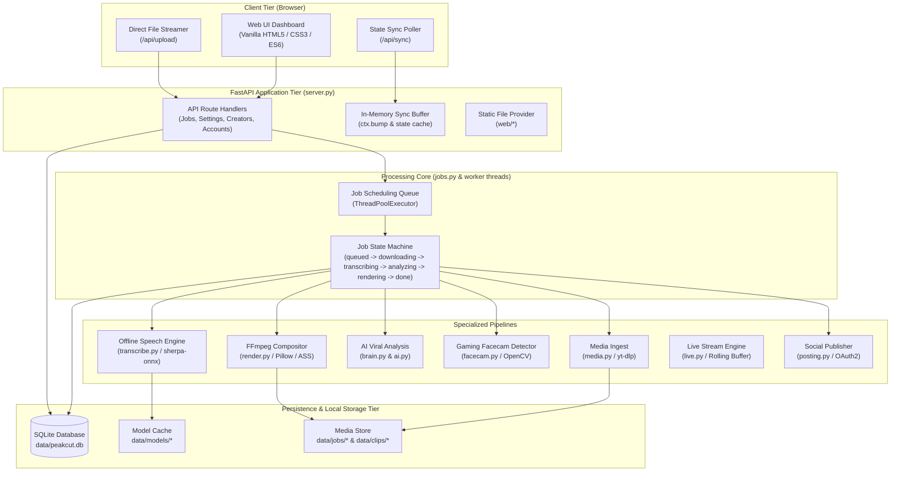
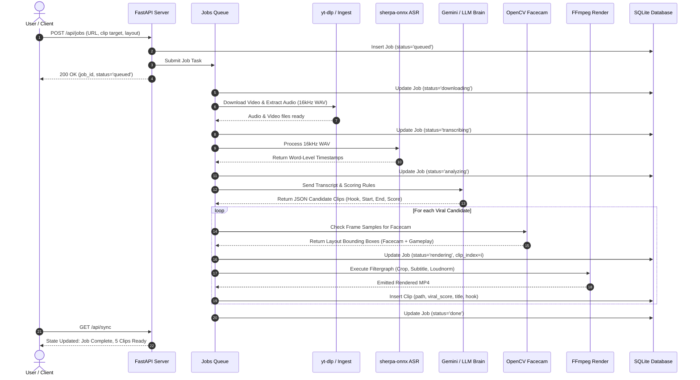
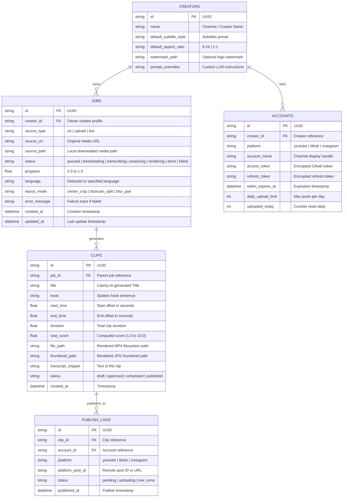
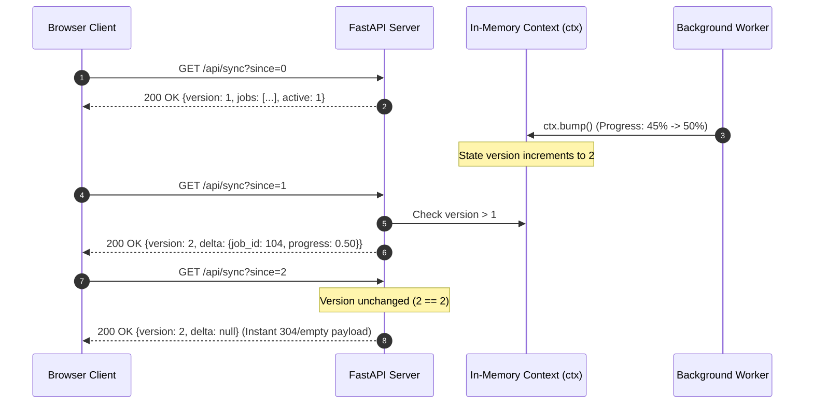

# Clipper — System Architecture & Technical Design

This document details the software architecture, module decomposition, data flow, concurrency model, and database entity relationships of the **Clipper** system.

---

## 1. High-Level Architectural Principles

Clipper is designed around five core engineering principles:

1. **Single-Process Async Micro-Kernel**: The backend runs as a single async Python process using FastAPI and Uvicorn. There are no heavy external task broker requirements (no Celery, Redis, or RabbitMQ required for local execution).
2. **Zero-Dependency Frontend**: The user interface is pure, modern vanilla HTML5, CSS3, and JavaScript. It requires no `node_modules`, `npm install`, Webpack, or Vite build steps, ensuring instant startup and low disk footprint.
3. **Hybrid Local/Cloud Processing**: Heavy media operations (audio demuxing, speech recognition, visual computer vision, video rendering) execute 100% locally on the host CPU/GPU. Generative reasoning (transcript context analysis, virality scoring) utilizes cloud LLMs with local fallback support.
4. **Resilient Job State Machine**: Video processing tasks follow a deterministic multi-stage lifecycle with state persistence in SQLite, enabling cancellation, retries, and atomic error reporting.
5. **Real-Time Client Synchronization**: Lightweight memory-buffered state tracking (`ctx.bump()`) allows frontend clients to poll `/api/sync` efficiently without triggering repeated database queries.

---

## 2. High-Level Architecture Diagram

---

## 3. Technology Stack Matrix

| Layer | Component | Technology / Library | Purpose |
| :--- | :--- | :--- | :--- |
| **Web Server** | ASGI Framework | **FastAPI 0.115+** | High-performance asynchronous REST API routing |
| **ASGI Engine**| Server Runner | **Uvicorn** | Fast event-loop ASGI server with hot-reloading |
| **Frontend** | Client Dashboard | **Vanilla HTML5 / CSS3 / JS** | Zero-bundle responsive UI with real-time sync |
| **Media Extraction** | Downloader | **yt-dlp** | Robust video and audio stream extraction from 1000+ sites |
| **ASR Speech** | Offline Transcriber| **sherpa-onnx** | Quantized NeMo Parakeet TDT 0.6B INT8 offline speech recognition |
| **AI LLM** | Viral Candidate Selector| **Google Gemini API / OpenAI / Ollama** | Context reasoning, virality scoring, hook titling, JSON structured output |
| **Computer Vision** | Face & Webcam Detection| **OpenCV (headless) & Pillow** | Temporal edge variance calculation, facecam bounding box isolation |
| **Video Engine** | Compositor & Encoder | **FFmpeg & FFprobe (Gyan 9.0+)** | Complex filtergraphs, scaling, pad, overlay, audio loudnorm, H.264/AAC |
| **Database** | Relational Store | **SQLite3 & SQLAlchemy 2.0+** | Local persistence of jobs, clips, creator profiles, and OAuth credentials |

---

## 4. Module-by-Module Breakdown

### 4.1. `peakcut/server.py`
The central HTTP entry point.
- Configures FastAPI routes for jobs, settings, creators, media streaming, and live feeds.
- Serves static assets from the `web/` directory.
- Manages the `/api/sync` endpoint: uses atomic counter bumping (`ctx.bump()`) so clients only receive payload updates when state actually changes.

### 4.2. `peakcut/jobs.py`
The execution orchestrator.
- Manages the job lifecycle: `queued` $\to$ `downloading` $\to$ `transcribing` $\to$ `analyzing` $\to$ `rendering` $\to$ `done` (or `failed`).
- Enforces concurrency limits to prevent CPU exhaustion during parallel FFmpeg rendering.
- Handles atomic cancellation signals: if a user cancels a job in the UI, child subprocesses (FFmpeg / yt-dlp) are terminated cleanly.

### 4.3. `peakcut/transcribe.py`
The local offline speech-to-text runner.
- Initializes the `sherpa-onnx` runtime using the NeMo Parakeet TDT INT8 model.
- Transcribes extracted audio chunks without network requests.
- Emits words with millisecond-accurate start and end timestamps (`[{word: "Hello", start: 0.12, end: 0.45}, ...]`).

### 4.4. `peakcut/brain.py` & `peakcut/ai.py`
The viral intelligence engine.
- Formulates multi-turn prompts containing full timestamped transcripts.
- Instructs the LLM to identify high-retention segments using Hook-Story-Payoff metrics.
- Enforces strict JSON schema validation on the AI response with automated syntactic auto-repair if the model outputs malformed JSON.

### 4.5. `peakcut/facecam.py`
The computer vision layout engine.
- Samples video frames across temporal intervals.
- Computes edge variance to detect static HUD boundaries (e.g., gamer facecam overlays).
- Verifies facial presence using lightweight Haar/YuNet cascades.
- Emits crop coordinates: top box (facecam) and bottom box (gameplay action).

### 4.6. `peakcut/render.py`
The FFmpeg composite builder.
- Generates subtitle overlays: uses Pillow to render high-DPI subtitle frames or compiles ASS subtitle scripts with word-level highlight tags (`\k`).
- Compiles complex FFmpeg filtergraphs: crops, aspect-ratio pads, overlays facecam and subtitles, and normalizes audio levels via `loudnorm`.
- Encodes the final MP4 using `libx264` and `aac`.

### 4.7. `peakcut/live.py`
The live stream monitoring daemon.
- Connects to ongoing live streams (Twitch, YouTube Live).
- Maintains a local rolling circular buffer of the last 15-30 minutes of video.
- Analyzes live chat velocity (spikes in messages per second) and audio decibel surges to auto-detect moments of peak excitement.

### 4.8. `peakcut/posting.py` & `peakcut/db.py`
Publishing and persistence.
- Handles OAuth2 token refresh workflows for YouTube, TikTok, and Instagram.
- Schedules uploads according to user-defined publishing windows.
- Manages SQLite database schema migrations and transactions.

---

## 5. End-to-End Pipeline Sequence Diagram

---

## 6. Database Entity-Relationship Diagram (ERD)

The SQLite relational schema (`data/peakcut.db`) governs jobs, generated clips, creator settings, and publishing logs:

---

## 7. Real-Time State Synchronization Mechanism

To maintain responsive UI state across browser tabs without WebSockets or server overhead:

