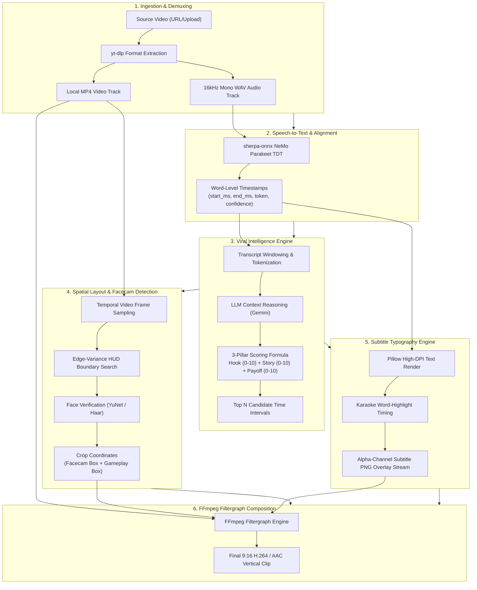
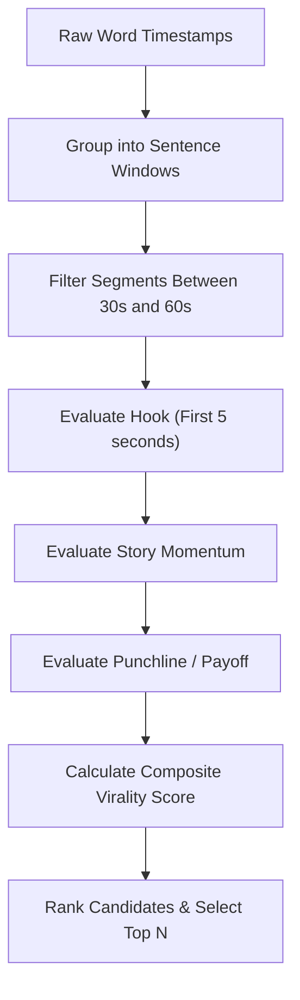
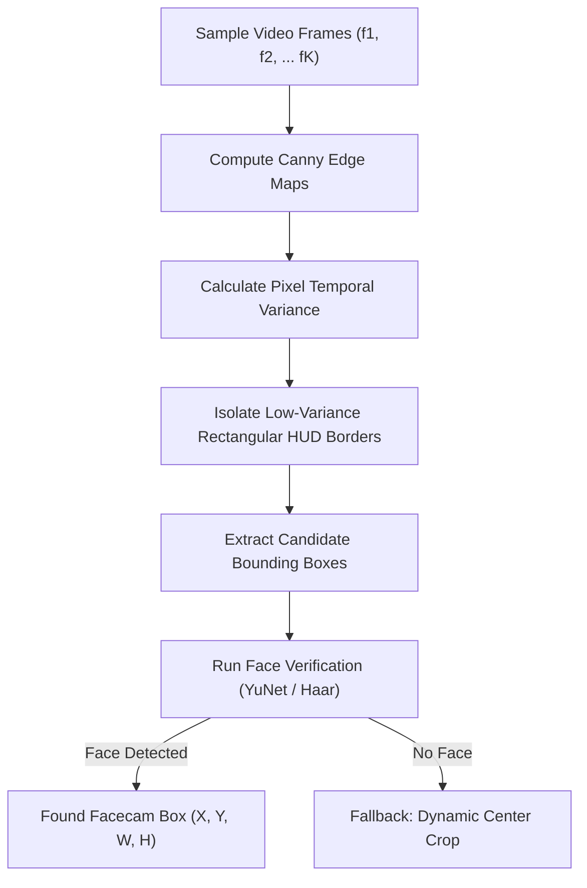
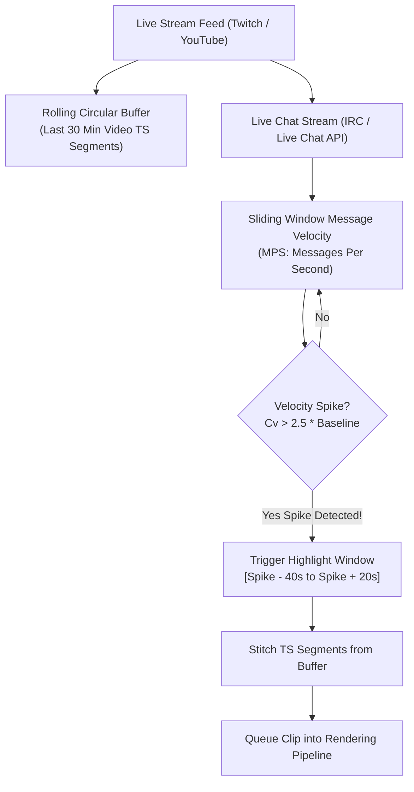
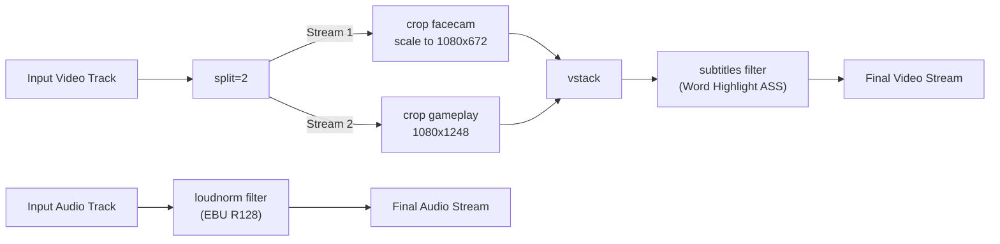

# Clipper — Pipeline & Algorithm Deep-Dive

This document provides a technical deep-dive into the algorithms, mathematical models, computer vision heuristics, and video compositing pipelines powering **Clipper**.

---

## 1. End-to-End Pipeline Overview

The core Clipper processing pipeline transforms raw video input into high-engagement vertical clips through six sequential phases:



---

## 2. Audio Ingestion & Offline Speech-to-Text

### 2.1. Extraction & Conditioning
Raw audio is extracted using `ffmpeg` into a normalized format required for optimal ASR inference:
- **Sample Rate**: 16,000 Hz (16 kHz).
- **Channels**: 1 (Mono).
- **Bit Depth**: 16-bit Linear PCM.
- **Dynamic Range Compression**: Light normalization applied to equalize quiet speech and loud screams.

### 2.2. Offline ASR Engine (`sherpa-onnx`)
Clipper utilizes `sherpa-onnx` running the **NeMo Parakeet TDT 0.6B (INT8 quantized)** model:
- **Architecture**: Transducer with Token-and-Duration Transducer (TDT) decoding.
- **Model Size**: ~480 MB (stored locally in `data/models/`).
- **Inference Speed**: ~10x to 15x real-time speed on a modern multi-core CPU (a 60-minute podcast transcribes in ~4 to 5 minutes without needing an expensive GPU).
- **Output Structure**: Emits continuous tokens with word-level timestamps:
  ```json
  [
    {"word": "The", "start": 1.12, "end": 1.28, "prob": 0.98},
    {"word": "biggest", "start": 1.30, "end": 1.64, "prob": 0.99},
    {"word": "mistake", "start": 1.66, "end": 2.10, "prob": 0.95}
  ]
  ```

---

## 3. Viral Candidate Selection Algorithm

The transcript is evaluated by the generative AI engine (`peakcut/brain.py`) using structured prompts.

### 3.1. The 3-Pillar Virality Scoring Formula
Every candidate segment is evaluated against three core viewer retention metrics, yielding a composite Virality Score ($V$):

$$V = 0.40 \cdot H + 0.35 \cdot E + 0.25 \cdot P$$

Where:
- **$H$ (Hook Strength, 0–10)**: Measures the captivating quality of the first 3 to 5 seconds. Does it provoke curiosity, shock, controversy, or ask an urgent question?
- **$E$ (Engagement & Pacing, 0–10)**: Measures informational density and narrative momentum. Does the speaker maintain interest without meandering filler?
- **$P$ (Payoff & Climax, 0–10)**: Measures the conclusion. Is there a punchline, valuable insight, counter-intuitive takeaway, or clear resolution?

### 3.2. Structural Constraints
- **Duration**: Constrained between $T_{\min} = 30\text{s}$ and $T_{\max} = 60\text{s}$.
- **Sentence Integrity**: Must start on a complete opening thought and terminate at a natural sentence boundary (avoiding abrupt mid-sentence cutoffs).
- **No Overlap**: Identified clips must not overlap by more than 15% to ensure diverse highlights.



---

## 4. Computer Vision: Gaming Facecam & Layout Detection

When converting standard horizontal 16:9 gameplay streams into vertical 9:16 shorts, simply center-cropping the video cuts off either the player's facecam or the game action. Clipper solves this using automated computer vision (`peakcut/facecam.py`).

### 4.1. Temporal Edge Variance Algorithm
Webcams and streamer facecam boxes are typically static HUD overlays positioned in a fixed corner (top-left, top-right, bottom-left, or bottom-right).

1. **Frame Sampling**: Extract $K$ frames spaced across the video duration:
   $$F = \{f_1, f_2, \dots, f_K\} \quad (K \approx 10\text{ to }20)$$
2. **Canny Edge Detection**: Compute edge maps $E_i = \text{Canny}(f_i)$ for all sampled frames.
3. **Variance Accumulator**: Calculate pixel-wise temporal variance across the edge maps:
   $$\sigma^2(x, y) = \frac{1}{K} \sum_{i=1}^K \left(E_i(x, y) - \mu_E(x, y)\right)^2$$
   - The *inner content* of the webcam (the streamer moving) has high variance.
   - The *border box* of the webcam is a static edge with near-zero temporal variance.
   - By thresholding and finding contours on the static edge map, rectangular HUD candidate regions are isolated.

4. **Face Verification**:
   Crop candidate boxes and pass them through a lightweight OpenCV YuNet face detector to verify the presence of human facial landmarks.



### 4.2. Composite 9:16 Split Layout
Once the facecam rectangle is identified:
- **Upper Section (Top 35% of 9:16 frame)**: Facecam box cropped, scaled, and placed at top.
- **Lower Section (Bottom 65% of 9:16 frame)**: Gameplay center-cropped to 9:16 and placed below.

```
+---------------------------+  <-- 1080 x 1920 (9:16 Frame)
|                           |
|       STREAMER FACECAM    |  (Cropped from detected HUD box)
|          (Top 35%)        |
+---------------------------+
|                           |
|                           |
|       GAMEPLAY ACTION     |  (Center-cropped action area)
|         (Bottom 65%)      |
|                           |
|     [ SUBTITLES HERE ]    |
|                           |
+---------------------------+
```

---

## 5. Live Stream Circular Buffer & Chatter Velocity

For 24/7 stream monitoring (`peakcut/live.py`), Clipper continuously monitors incoming video and live chat feeds.

### 5.1. Rolling Circular Video Buffer
- Ingests incoming HLS/DASH streams into rotating 60-second `.ts` segments on disk.
- Retains a sliding window of the last 30 minutes of video. Segments older than 30 minutes are automatically pruned to prevent disk overflow.

### 5.2. Chatter Velocity & Excitement Trigger
The system tracks chat message velocity ($C_v$) measured in messages per second (MPS) over a sliding 10-second window:

$$C_v(t) = \frac{N_{\text{messages}}(t - 10\text{s}, t)}{10}$$

When $C_v(t)$ exceeds 2.5 times the rolling 10-minute baseline average:

$$C_v(t) > 2.5 \cdot \mu_{\text{baseline}}$$

An excitement trigger fires:
1. The system marks a trigger timestamp $t_{\text{spike}}$.
2. Clipper captures the segment $[t_{\text{spike}} - 40\text{s}, t_{\text{spike}} + 20\text{s}]$.
3. The 60-second clip is queued into the transcription and rendering pipeline automatically.



---

## 6. Subtitle Typography & FFmpeg Filtergraph

### 6.1. Word-by-Word Karaoke Highlighting
To maximize viewer retention, subtitles are displayed 2 to 4 words at a time with the currently spoken word highlighted in bright yellow/green with an active scale pop.

1. **Windowing**: Group adjacent words into 1.5-second readable visual clusters.
2. **Typography Engine**:
   - Subtitles are rasterized with high-DPI anti-aliasing via Pillow using bold geometric sans-serif fonts (e.g., *Montserrat ExtraBold* or *Impact*).
   - A thick outer black border (stroke width: 8–12px) and drop-shadow are applied to guarantee legibility over any background.
3. **Word Timing**: Each word in the cluster turns yellow during its exact $[t_{\text{start}}, t_{\text{end}}]$ duration.

### 6.2. Complex FFmpeg Filtergraph Construction
The entire video composition is rendered in a single-pass FFmpeg process to avoid lossy multi-generation encoding:

```bash
ffmpeg -y -ss 00:01:15.000 -to 00:02:05.000 -i input.mp4 \
  -filter_complex "
    [0:v]split=2[cam][game];
    [cam]crop=480:360:1440:0,scale=1080:672:flags=lanczos[top];
    [game]crop=1080:1248:420:300[bottom];
    [top][bottom]vstack[stacked];
    [stacked]subtitles=captions.ass:force_style='FontName=Montserrat,FontSize=28,PrimaryColour=&H0000FFFF'[vfinal];
    [0:a]loudnorm=I=-14:LRA=11:TP=-1.5[afinal]
  " \
  -map "[vfinal]" -map "[afinal]" \
  -c:v libx264 -preset fast -crf 20 -c:a aac -b:a 192k \
  output_clip.mp4
```


