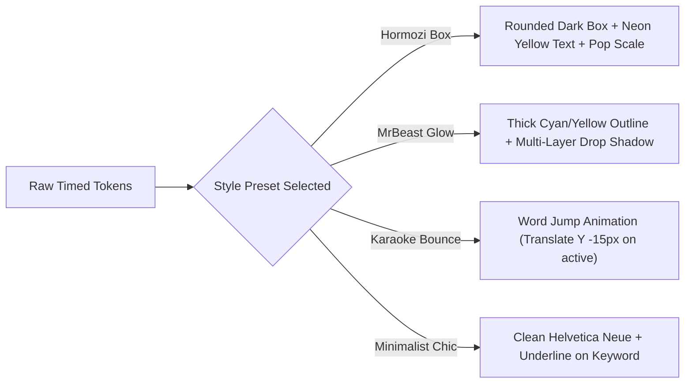
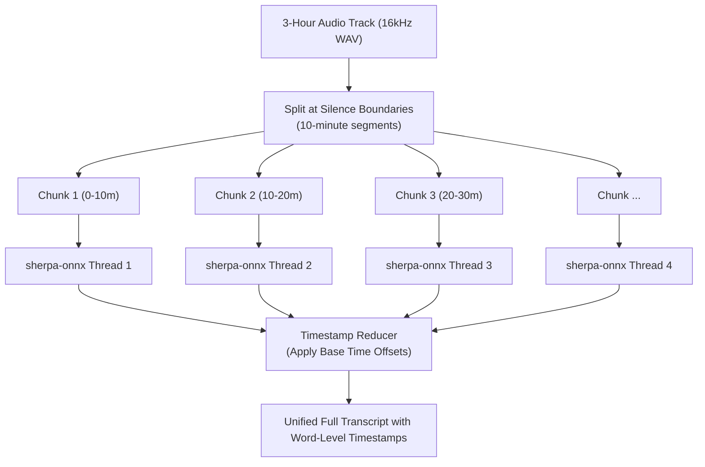
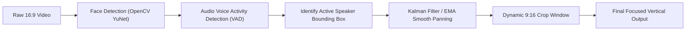
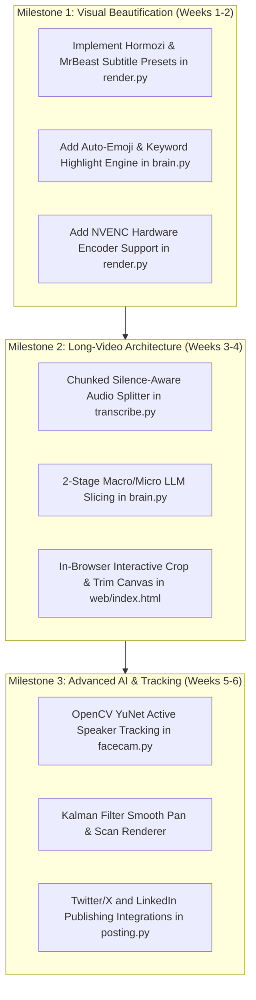

# Clipper — Local Enhancement Roadmap & Future Architecture

This roadmap details actionable plans, architectural extensions, and concrete code modifications to enhance **Clipper** locally. It focuses on making outputs significantly more visually engaging, supporting 2-to-4 hour long-form videos with high performance, and adding active speaker tracking.

---

## 1. Executive Enhancement Matrix

| Feature Area | Enhancement | Impact | Complexity | Target Modules |
| :--- | :--- | :--- | :--- | :--- |
| **Aesthetics** | Modern Viral Captions (Hormozi, MrBeast glow) | High | Medium | `render.py`, `web/index.html` |
| **Aesthetics** | Auto-Emoji & Keyword Highlight Engine | High | Low | `brain.py`, `render.py` |
| **Aesthetics** | Sound Effects (SFX) Audio Layering | High | Medium | `render.py` |
| **Aesthetics** | In-Browser Canvas Clip Trimmer & Crop Adjuster | High | Medium | `web/index.html`, `server.py` |
| **Long Videos** | Chunked Map-Reduce Transcription | Critical | Medium | `transcribe.py`, `jobs.py` |
| **Long Videos** | Hierarchical 2-Stage LLM Slicing | High | Low | `brain.py` |
| **Performance** | GPU Hardware Acceleration (NVENC / QSV / AMF) | High | Low | `render.py`, `.env` |
| **Framing** | Active Speaker Face Tracking (Pan & Scan) | Critical | High | `facecam.py`, `render.py` |
| **Distribution** | X (Twitter) & LinkedIn Video Publishing | Medium | Low | `posting.py` |

---

## 2. Aesthetics: Making Clips More Beautiful & Viral

### 2.1. Modern Viral Subtitle Presets
Modern vertical shorts viewers expect dynamic, animated captions. We can introduce four distinct preset styles into `render.py`:



#### Technical Implementation (Advanced ASS / Pillow Frame Generator):
Using Advanced SubStation Alpha (`.ass`) style tags:
- **Pop-in Zoom Effect**: `\t(0, 100, \fscx115\fscy115)\t(100, 200, \fscx100\fscy100)` expands the active word by 15% and bounces it back to 100% within 200ms.
- **Glowing Stroke**: Multi-pass border tags `\blur5\bord8` to create a vivid glow effect behind the text.

### 2.2. Automated Emojis & Keyword Highlights
When a speaker says words like "money", "growth", "danger", or "idea", inserting an animated emoji directly above the text significantly boosts retention.

#### How It Works:
1. In `brain.py`, add a keyword-to-emoji mapping dictionary and prompt instruction:
   ```json
   {
     "text": "The secret to real wealth is compounding",
     "emojis": [{"word": "wealth", "emoji": "💰"}, {"word": "compounding", "emoji": "📈"}]
   }
   ```
2. In `render.py`, load Apple / Twemoji PNG assets from a local `data/emojis/` folder and composite them directly onto the subtitle overlay track at the corresponding timestamp.

### 2.3. Dynamic Audio Sound Effects (SFX)
Auto-insert subtle audio effects at key moments:
- **Whoosh sound** on major scene or camera transitions.
- **Subtle "Pop" / "Click"** when new emoji stickers appear.
- **Low-frequency Bass Boom** at the hook statement.
- Implemented via FFmpeg `amix` and `adelay` audio filtergraphs.

### 2.4. In-Browser Interactive Clip Trimmer & Crop Preview
Currently, clip boundaries are chosen entirely by AI. Adding a lightweight HTML5 Canvas tool in `web/index.html` allows users to:
- Drag handles to trim start/end times by $\pm 5$ seconds.
- Drag a visual crop rectangle over the video to manually adjust the facecam or gameplay framing before triggering the final render.

---

## 3. Scaling for Long-Form Videos (2–4 Hour Podcasts & VODs)

Processing a 3-hour podcast currently requires significant memory and can exceed LLM context windows. Below is the architecture for scalable long-video support.

### 3.1. Chunked Map-Reduce Transcription
Instead of loading a 3-hour audio file into memory:
1. **Split**: FFmpeg segments the audio into 10-minute WAV chunks at sentence/silence boundaries (`silencedetect`).
2. **Parallel Map**: `sherpa-onnx` processes chunks concurrently across available CPU threads.
3. **Reduce**: Concatenate timestamps by offsetting each chunk by its starting timestamp.



### 3.2. Hierarchical 2-Stage LLM Slicing
Feeding a 3-hour transcript (over 40,000 words) into a single LLM prompt can cause hallucinations and high token costs.
- **Stage 1 (Macro Windowing)**: The full transcript is divided into 5-minute blocks. The LLM evaluates each block's topic and assigns a quick "Virality Density" score (1–10).
- **Stage 2 (Micro Extraction)**: Only the top 20% highest-scoring blocks are fed into the detailed Hook-Story-Payoff extractor for millisecond-precision candidate selection.

### 3.3. GPU Hardware Acceleration (NVENC / QSV / AMF)
Rendering vertical 1080x1920 video with multiple filtergraphs on CPU (`libx264`) takes ~30–45 seconds per clip. Using hardware encoding cuts this to **3–5 seconds**.

#### Configuration in `.env`:
```env
PEAKCUT_FFMPEG_ENCODER=h264_nvenc   # NVIDIA GPU
# PEAKCUT_FFMPEG_ENCODER=h264_qsv   # Intel QuickSync
# PEAKCUT_FFMPEG_ENCODER=h264_amf   # AMD Radeon
```

#### Code Change in `peakcut/render.py`:
```python
encoder = os.getenv("PEAKCUT_FFMPEG_ENCODER", "libx264")
if encoder == "h264_nvenc":
    extra_args = ["-c:v", "h264_nvenc", "-preset", "p6", "-tune", "hq"]
else:
    extra_args = ["-c:v", "libx264", "-preset", "fast", "-crf", "20"]
```

---

## 4. Active Speaker Tracking (Pan & Scan)

In multi-person podcasts or interviews (e.g., Joe Rogan, Lex Fridman), static center-cropping often cuts between speakers or captures empty space between them. Active Speaker Tracking dynamically pans the camera to whoever is currently talking.



### 4.1. Algorithmic Workflow
1. **Face Detection**: At each frame (or every 5th frame), detect all human faces with bounding boxes:
   $$B_i = (x_i, y_i, w_i, h_i)$$
2. **Audio-Visual Association**:
   - Determine who is speaking by matching audio energy with facial landmark motion (mouth aspect ratio $MAR$).
   - If Speaker A is speaking, target their bounding box center $X_{\text{target}}$.
3. **Smooth Exponential Panning (EMA)**:
   Avoid jerky camera jumps by smoothing the horizontal crop position $X_t$ using an Exponential Moving Average:
   $$X_t = \alpha \cdot X_{\text{target}} + (1 - \alpha) \cdot X_{t-1} \quad (\alpha \approx 0.08)$$
4. **FFmpeg `crop` filter**: Pass the smooth trajectory $(X_t, Y_t)$ into FFmpeg using dynamic expression evaluation.

---

## 5. Multi-Platform Expansion (X / Twitter & LinkedIn)

To complement YouTube Shorts, TikTok, and Instagram, Clipper can expand to professional and micro-blogging video feeds:

### 5.1. X (Twitter) Video API
- Uses Twitter API v2 chunked media upload (`INIT`, `APPEND`, `FINALIZE`).
- Enables auto-posting vertical clips with tweet copy, hashtags, and thread links to the full video.

### 5.2. LinkedIn Video API
- Uses the LinkedIn Assets API (`registerUpload` and chunked PUT).
- Tailors AI-generated copy to professional takeaways, leadership summaries, and business insights.

---

## 6. Implementation Roadmap Timeline


